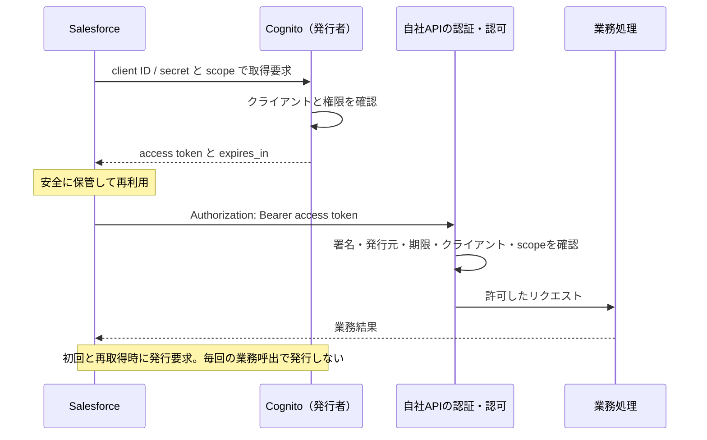

# API認証とCognito M2Mの詳解

公式資料確認日：2026-10-14（日本時間）

前提：**Salesforceから、自社のCognitoで保護されたAPIを呼ぶM2M連携**。提示された設定値を入力情報として扱い、実環境の設定読み取りやトークン発行は行っていません。

Excelと本Markdownは同じ解説本文から作成しています。Excelには発行回数の試算欄、通信フロー表、期限の時系列表があります。

## 00 質問への回答と前提

前提：Salesforceが自社のCognitoで保護されたAPIを呼び出す。人がログインしないM2Mを扱う。公式資料の確認日：2026年10月14日。

### 結論：誰が発行するか

Salesforceが「トークンをください」と要求し、Cognitoがアクセストークンを作って返します。自社APIはそれを検証して、許可した処理だけを実行します。

実行時の発行主体はCognitoです。Salesforce側の連携機能・プログラムが取得要求と保管・再取得を担います。人は事前の設定と運用を担当し、通常はAPI呼び出しのたびに手作業で発行しません。

根拠・区分：[S01 AWS：Cognito token endpoint](https://docs.aws.amazon.com/cognito/latest/developerguide/token-endpoint.html) [S02 AWS：Scopes, M2M, and resource servers](https://docs.aws.amazon.com/cognito/latest/developerguide/cognito-user-pools-define-resource-servers.html) [S21 Salesforce：OAuth External Credential: Client Credentials with Client Secret](https://help.salesforce.com/s/articleView?id=sf.nc_create_edit_oath_client_secret_ext_cred.htm&language=en_US)

### OAuthか、取得APIか

通常、この2つは同じ流れの中にあります。OAuthは「許可証をもらって使うための約束事」で、トークン取得APIはその約束事の受付窓口です。

今回の標準的な方式はOAuth 2.0のclient_credentialsです。自社で「API認可トークン取得API」と名付けたものが、Cognitoの/oauth2/tokenそのものか、そこへ中継する独自APIかは未確認です。

根拠・区分：[S01 AWS：Cognito token endpoint](https://docs.aws.amazon.com/cognito/latest/developerguide/token-endpoint.html) [S24 IETF：RFC 6749: OAuth 2.0](https://www.rfc-editor.org/rfc/rfc6749)

### Salesforce APIの意味

ご回答に基づき、Salesforceから自社APIへ接続する方向で説明します。

自社がSalesforceのREST APIを呼ぶ逆方向とは発行者が異なります。本資料のトークンはCognito発行です。Salesforce自身のAPI用アクセストークンや接続アプリの説明を混ぜません。

根拠・区分：ユーザー確認

### イントラネットAPI

ご提示の仕様は、リクエストのヘッダーにAPI-Keyを付けて利用する方式です。

API-Keyをどの装置・処理が照合するかは未確認です。AWS API Gateway標準のAPIキーなら、AWSは認証・認可そのものに用いないよう案内しています。独自のキー認証との区別、IAM等の併用を確認します。

根拠・区分：ユーザー提示 [S13 AWS：Usage plans and API keys](https://docs.aws.amazon.com/apigateway/latest/developerguide/api-gateway-api-usage-plans.html)

### API-Keyというヘッダー名

API-Keyという名前と、AWS標準のx-api-keyという名前は同じではありません。

HTTPヘッダーの大文字小文字は通常区別しませんが、API-Keyとx-api-keyでは文字列自体が違います。実際のAPI仕様書・リクエスト例・ゲートウェイ設定で確定します。

根拠・区分：設計確認

### インターネット側の取得API

図に書かれていないだけで「独自の取得APIが必ずある」とは断定できません。

Cognitoのclient_credentialsを採用するなら取得経路が必要です。Cognitoの共通エンドポイントへ直接接続する構成、中継APIを使う構成、最新のGetClientTokenを使う構成などがあります。実環境のURL・設定を見て判断します。

根拠・区分：[S01 AWS：Cognito token endpoint](https://docs.aws.amazon.com/cognito/latest/developerguide/token-endpoint.html) [S17 AWS：GetClientToken](https://docs.aws.amazon.com/cognito-user-identity-pools/latest/APIReference/API_GetClientToken.html)

### インターネット側の発行者

そのAPIもCognitoで保護する設計なら、発行者はCognitoです。取得を要求するのは外部の連携システムです。

別の認可サーバーを採用していれば発行者も変わります。「インターネットAPI」という分類だけでは、OAuthの採用、Cognito利用、client_credentials利用を確定できません。

根拠・区分：[S02 AWS：Scopes, M2M, and resource servers](https://docs.aws.amazon.com/cognito/latest/developerguide/cognito-user-pools-define-resource-servers.html) 設計確認

### トークンは再利用できるか

はい。同じ有効なアクセストークンを、許されたAPIへ何度も送れます。使うたびに1枚ずつ消費する券ではありません。

期限、発行元、対象クライアント、scope、API側の許可条件を満たす必要があります。通常のBearerでは並行利用も可能です。ただし別の利用者・連携先への配布や、scope外のAPIへの流用はしません。

根拠・区分：[S25 IETF：RFC 6750: Bearer Token Usage](https://www.rfc-editor.org/rfc/rfc6750) [S12 AWS：Token expiration and caching](https://docs.aws.amazon.com/cognito/latest/developerguide/amazon-cognito-user-pools-using-tokens-caching-tokens.html)

### 60分とは何か

Cognitoが発行した時点からの有効期間です。10時に発行し期限が11時なら、10時50分に使っても期限は11時のままです。

最終利用から60分ではありません。API側はトークンのexpを確認します。正常利用の回数や頻度で寿命が伸びることはなく、新しいトークンは別途取得します。

根拠・区分：[S04 AWS：Understanding the access token](https://docs.aws.amazon.com/cognito/latest/developerguide/amazon-cognito-user-pools-using-the-access-token.html) [S26 IETF：RFC 7519: JSON Web Token](https://www.rfc-editor.org/rfc/rfc7519)

### 30日・1時間・3分の関係

今回のM2Mで発行されるのはアクセストークンだけです。30日、IDトークンの1時間、認証途中の3分を、アクセストークンの期限に足したり掛けたりしません。

client_credentialsではrefresh tokenとID tokenが発行されず、MFA等の人の認証チャレンジも行いません。画面に表示される共通設定すべてが、このフローで働くわけではありません。

根拠・区分：[S03 AWS：Application-specific settings with app clients](https://docs.aws.amazon.com/cognito/latest/developerguide/user-pool-settings-client-apps.html) [S07 AWS：Authentication flow session duration](https://docs.aws.amazon.com/cognito/latest/developerguide/authentication-flow-things-to-know.html)

### 取消を有効にした効果

「取消を有効化」は、M2Mトークンをどこでも即時無効化するスイッチではありません。

Cognitoの標準revokeはrefresh tokenを対象とします。M2Mではそれが発行されません。さらに署名と期限だけを見るAPIには取消情報が自動伝播しません。緊急停止は新規発行停止とAPI側拒否を分けて設計します。

根拠・区分：[S09 AWS：Ending user sessions with token revocation](https://docs.aws.amazon.com/cognito/latest/developerguide/token-revocation.html) [S10 AWS：The token revocation endpoint](https://docs.aws.amazon.com/cognito/latest/developerguide/revocation-endpoint.html)

### 性能試験への影響

インターネットAPIの業務呼び出しを試験対象外とする整理はできます。ただし共有基盤への影響までゼロとは言い切れません。

Salesforce連携が試験対象なら、そのトークン取得・再取得と検証は対象です。共通のCognito、ゲートウェイ、認証Lambda、バックエンド、クォータを使うか確認して、除外の妥当性を判断します。

根拠・区分：[S12 AWS：Token expiration and caching](https://docs.aws.amazon.com/cognito/latest/developerguide/amazon-cognito-user-pools-using-tokens-caching-tokens.html) [S19 AWS：Quotas in Amazon Cognito](https://docs.aws.amazon.com/cognito/latest/developerguide/quotas.html) 設計判断

### 提示値の扱い

設定値は利用者からの提示情報として扱っています。実際のAWS環境から読み取った値ではありません。

client IDとsecretの存在、refresh 30日、access 60分、ID 1時間、認証フロー3分、取消ON、存在エラー防止ONが入力情報です。値そのものの認証情報は受領していません。

根拠・区分：ユーザー提示

### M2Mという言葉の範囲

機械同士の通信すべてがclient_credentialsとは限りません。ここではご指定のM2Mを、Cognitoの機械用クライアント認証として説明します。

実環境のgrant_typeまたはGetClientToken利用を確認すると前提を確定できます。機械が人用のユーザー名・パスワードでログインしているなら、本資料の「refresh tokenなし」という整理をそのまま適用できません。

根拠・区分：[S02 AWS：Scopes, M2M, and resource servers](https://docs.aws.amazon.com/cognito/latest/developerguide/cognito-user-pools-define-resource-servers.html) 設計確認

### 読む順序

まずこのシートと「03_Cognito設定」で結論を確認し、その後に通信の流れと期限の例を読むと理解しやすくなります。

「07_性能試験」には入力値を変更できる試算を用意しています。数値例は説明用で、実システムの測定結果ではありません。末尾には用語、根拠資料、設計担当への確認事項をまとめています。

根拠・区分：資料の使い方

## 01 認証・認可・トークンの仕組み

学校の図書室に、配送ロボットが本を取りに来る例で考える。例え話の後に実際の技術との対応を示す。

### APIは受付窓口

APIは、別のコンピューターから仕事を頼むための窓口です。ロボットが図書室の窓口で「本の一覧をください」と頼むようなものです。

例としてGET /booksは一覧取得、POST /ordersは注文登録という依頼です。通信経路が社内かインターネットかという分類と、どの資格情報を確認するかという分類は別です。

根拠・区分：説明用の例

### M2Mは機械同士の連携

M2MはMachine to Machineの略です。人が画面で毎回ログインせず、決められた機械が自動で処理します。

Salesforceの定期連携、イベントを契機とする送信、バッチ処理などが該当します。人のアカウントを代理利用する方式と区別し、アプリそのものに許可を与えます。

根拠・区分：[S02 AWS：Scopes, M2M, and resource servers](https://docs.aws.amazon.com/cognito/latest/developerguide/cognito-user-pools-define-resource-servers.html)

### 認証：あなたは誰か

受付が「登録済みの配送ロボット本人か」を確かめることです。名前を名乗るだけでは足りず、秘密の合言葉などの証拠も使います。

今回、Cognitoはclient IDとclient secretの組合せでクライアントを確認します。API側では受け取ったトークンが信頼する発行者の本物かを検証します。

根拠・区分：[S01 AWS：Cognito token endpoint](https://docs.aws.amazon.com/cognito/latest/developerguide/token-endpoint.html) [S24 IETF：RFC 6749: OAuth 2.0](https://www.rfc-editor.org/rfc/rfc6749)

### 認可：何をしてよいか

本人だと分かっても、全部の部屋に入れるわけではありません。「本を見るのはよいが、先生の記録は見られない」と決めることです。

scopeは許された操作の目印です。たとえばorders/readとorders/writeを分けます。認証成功だけで全データや全操作を許可せず、業務上の対象データ制限もAPI側で確認します。

根拠・区分：[S02 AWS：Scopes, M2M, and resource servers](https://docs.aws.amazon.com/cognito/latest/developerguide/cognito-user-pools-define-resource-servers.html)

### OAuthの位置づけ

OAuth 2.0は、アプリに限られた許可を渡すための共通ルールです。「本人確認を含む許可証の受け渡し手順」と考えると分かりやすくなります。

OAuth自体の主目的は認可です。client_credentialsではアプリの認証を経て、そのアプリ自身にアクセス権を与えます。人の本人情報をやりとりするOpenID Connectとは目的が異なります。

根拠・区分：[S24 IETF：RFC 6749: OAuth 2.0](https://www.rfc-editor.org/rfc/rfc6749) [S28 OpenID Foundation：OpenID Connect Core 1.0](https://openid.net/specs/openid-connect-core-1_0.html)

### Salesforceの役割

本を取りに来るロボット役です。必要なときに受付へ許可証を取りに行き、保管して使います。

OAuth clientに相当します。Salesforce標準のExternal Credential / Named Credentialを使う場合はプラットフォームが取得処理を担います。独自Apexや中継基盤なら、その実装側が担います。

根拠・区分：[S21 Salesforce：OAuth External Credential: Client Credentials with Client Secret](https://help.salesforce.com/s/articleView?id=sf.nc_create_edit_oath_client_secret_ext_cred.htm&language=en_US) [S23 Salesforce：Use the Named Credential in a Callout](https://developer.salesforce.com/docs/platform/named-credentials/guide/nc-use-oauth-cred-in-callout.html)

### Cognitoの役割

登録台帳を見て許可証を発行する受付役です。図書室の本そのものを渡す係ではありません。

Authorization Serverです。クライアント認証、許可scopeの判定、有効期限の設定、JWTへの署名を行います。自社APIが実際の業務データを返します。

根拠・区分：[S01 AWS：Cognito token endpoint](https://docs.aws.amazon.com/cognito/latest/developerguide/token-endpoint.html) [S02 AWS：Scopes, M2M, and resource servers](https://docs.aws.amazon.com/cognito/latest/developerguide/cognito-user-pools-define-resource-servers.html)

### 自社APIの役割

入口の係員が許可証を調べ、許された本だけ渡す役です。

Resource Serverです。API GatewayのAuthorizer、独自ミドルウェア等が認証・認可を担う場合があります。実際にどこで検証するかはアーキテクチャで確認します。

根拠・区分：[S02 AWS：Scopes, M2M, and resource servers](https://docs.aws.amazon.com/cognito/latest/developerguide/cognito-user-pools-define-resource-servers.html) [S11 AWS：Verifying JSON web tokens](https://docs.aws.amazon.com/cognito/latest/developerguide/amazon-cognito-user-pools-using-tokens-verifying-a-jwt.html)

### 管理者の役割

事前にロボットを登録し、合言葉と入ってよい場所を決める人です。

AWS担当はアプリクライアント、scope、有効期限を設定します。Salesforce担当は資格情報と呼出先を登録し、利用権限を割り当てます。責任分担は組織で決めるため、担当部署名は推測しません。

根拠・区分：[S03 AWS：Application-specific settings with app clients](https://docs.aws.amazon.com/cognito/latest/developerguide/user-pool-settings-client-apps.html) [S21 Salesforce：OAuth External Credential: Client Credentials with Client Secret](https://help.salesforce.com/s/articleView?id=sf.nc_create_edit_oath_client_secret_ext_cred.htm&language=en_US) 設計判断

### client ID

ロボットについた登録番号です。どのアプリかを識別するために使います。

OAuth仕様上、ID単独は秘密の証明ではありません。IDを知っているだけでM2Mトークンを発行できてはいけません。環境・連携先ごとにクライアントを分けると権限と運用責任を追いやすくなります。

根拠・区分：[S24 IETF：RFC 6749: OAuth 2.0](https://www.rfc-editor.org/rfc/rfc6749) [S03 AWS：Application-specific settings with app clients](https://docs.aws.amazon.com/cognito/latest/developerguide/user-pool-settings-client-apps.html)

### client secret

許可証を受け取るための秘密の合言葉です。トークンを取得するときに使います。

長く使う資格情報なので厳重に保管します。アクセストークンやJWT署名用秘密鍵とは別物です。業務APIへの通常リクエストには、client secretの代わりに取得済みaccess tokenを付けます。

根拠・区分：[S01 AWS：Cognito token endpoint](https://docs.aws.amazon.com/cognito/latest/developerguide/token-endpoint.html)

### access token

受付が出す、期限と許可内容が書かれた通行証です。

Cognitoでは署名付きJWTとして発行されます。APIへAuthorization: Bearer <token>として送ります。client secretを毎回すべての業務APIに渡さずに済み、期限とscopeで使える範囲を絞れます。

根拠・区分：[S04 AWS：Understanding the access token](https://docs.aws.amazon.com/cognito/latest/developerguide/amazon-cognito-user-pools-using-the-access-token.html) [S25 IETF：RFC 6750: Bearer Token Usage](https://www.rfc-editor.org/rfc/rfc6750)

### refresh token

人が何度もログインし直さずに、新しい通行証を受け取るための引換券にたとえられます。

人のログインで使われます。Cognitoのclient_credentialsでは発行されません。M2Mはclient IDとsecretを使って新しいaccess tokenを取得できるため、今回の再取得に引換券は使いません。

根拠・区分：[S06 AWS：Refresh tokens](https://docs.aws.amazon.com/cognito/latest/developerguide/amazon-cognito-user-pools-using-the-refresh-token.html) [S03 AWS：Application-specific settings with app clients](https://docs.aws.amazon.com/cognito/latest/developerguide/user-pool-settings-client-apps.html)

### ID token

人の名前や本人確認の結果を伝える身分証のようなものです。

OpenID Connectの本人情報を伝えるトークンです。今回の機械用client_credentialsでは発行されず、業務API用access tokenの代用品にもなりません。

根拠・区分：[S05 AWS：Understanding the identity (ID) token](https://docs.aws.amazon.com/cognito/latest/developerguide/amazon-cognito-user-pools-using-the-id-token.html) [S28 OpenID Foundation：OpenID Connect Core 1.0](https://openid.net/specs/openid-connect-core-1_0.html)

### Bearerの意味

その通行証を持っている者が使える、という意味です。落として他人に拾われると、その人も使えてしまうおそれがあります。

通常のBearer tokenは、送信のたびに別の秘密鍵で所持者を証明する方式ではありません。同じトークンの正当な再利用と、盗まれたトークンの不正利用は区別して考えます。

根拠・区分：[S25 IETF：RFC 6750: Bearer Token Usage](https://www.rfc-editor.org/rfc/rfc6750)

### JWTの3つの部品

「封筒の説明」「許可の内容」「改ざんを見つける印」の3つでできたカードです。

JWTはheader.payload.signatureという形です。headerには署名方式と鍵ID、payloadには発行元・期限・scope等があります。内容の符号化は暗号化ではなく、読めるため秘密情報を入れない設計が必要です。

根拠・区分：[S26 IETF：RFC 7519: JSON Web Token](https://www.rfc-editor.org/rfc/rfc7519) [S11 AWS：Verifying JSON web tokens](https://docs.aws.amazon.com/cognito/latest/developerguide/amazon-cognito-user-pools-using-tokens-verifying-a-jwt.html)

### 署名は改ざん検知

誰かが「本を見るだけ」を「本を捨ててよい」に書き換えると、印の確認が失敗します。

Cognitoが秘密の署名鍵で署名し、自社APIが公開鍵で検証します。公開鍵から有効な署名を自由に作ることはできません。client secretを検証用公開鍵として使うわけでもありません。

根拠・区分：[S04 AWS：Understanding the access token](https://docs.aws.amazon.com/cognito/latest/developerguide/amazon-cognito-user-pools-using-the-access-token.html) [S11 AWS：Verifying JSON web tokens](https://docs.aws.amazon.com/cognito/latest/developerguide/amazon-cognito-user-pools-using-tokens-verifying-a-jwt.html)

### JWKSは公開鍵の一覧

係員が「受付の本物の印」を確かめるための見本帳です。見本帳自体は公開できます。

発行元に対応するJWKSを取得・キャッシュし、tokenのkidで鍵を選びます。tokenから受け取った任意URLをそのまま信用せず、信頼するissuerと鍵取得先を設定します。

根拠・区分：[S11 AWS：Verifying JSON web tokens](https://docs.aws.amazon.com/cognito/latest/developerguide/amazon-cognito-user-pools-using-tokens-verifying-a-jwt.html)

### HTTPSの役割

通行証や合言葉を、途中でのぞかれにくい封筒に入れて届ける道です。

JWTの署名は中身を隠しません。HTTPS/TLSは通信の盗聴・改ざん対策とサーバー確認を担います。Base64化したBasic認証の文字列も、暗号化された秘密ではありません。

根拠・区分：[S25 IETF：RFC 6750: Bearer Token Usage](https://www.rfc-editor.org/rfc/rfc6750)

### scopeの一致

「図書室の本を見る券」で、給食室の食材を書き換えることはできません。

トークン発行時はクライアントに許可したscopeだけを要求し、API側は必要scopeを確認します。scopeの文字列をJWTに入れるだけでは保護にならず、APIに拒否判断の実装・設定が必要です。

根拠・区分：[S02 AWS：Scopes, M2M, and resource servers](https://docs.aws.amazon.com/cognito/latest/developerguide/cognito-user-pools-define-resource-servers.html)

### ネットワークと認証は別

校内にいることと、鍵のかかった部屋に入ってよいことは別です。

イントラネットは到達範囲の制御、API認証はアクセス元の証明です。インターネットでも認証窓口が公開されているだけで誰にでもトークンを発行するわけではありません。

根拠・区分：設計の説明

### 4つのURLを分ける

許可証をもらう場所、本をもらう場所、発行元の名前、印の見本帳の場所はそれぞれ役割が違います。

token endpoint、業務API URL、issuer URL、jwks_uriは同一URLとは限りません。Cognitoの独自ドメインを使っても、その文字列を無条件にissuerとみなしてはいけません。実際のissuer設定と公式の発見情報に合わせます。

根拠・区分：[S01 AWS：Cognito token endpoint](https://docs.aws.amazon.com/cognito/latest/developerguide/token-endpoint.html) [S11 AWS：Verifying JSON web tokens](https://docs.aws.amazon.com/cognito/latest/developerguide/amazon-cognito-user-pools-using-tokens-verifying-a-jwt.html)

## 02 Salesforceから自社APIを呼ぶ流れ

標準OAuth方式の例。中継APIの有無、実際のURL、Salesforceの実装方法は未確認。



### 準備1：AWS担当

Salesforce用の受付登録を作ります。

Cognitoにsecret付きアプリクライアントを登録し、client_credentials、必要なcustom scope、有効期限を設定します。標準token endpointを使う場合はユーザープールドメインを設定します。

根拠・区分：[S03 AWS：Application-specific settings with app clients](https://docs.aws.amazon.com/cognito/latest/developerguide/user-pool-settings-client-apps.html)

### 準備2：API担当

入口が通行証を確認するように設定します。

信頼するissuerと署名鍵、許可クライアント、必要scope、期限・用途の確認を構成します。リクエストがAuthorizerを迂回して業務処理へ到達しない構造も確認します。

根拠・区分：[S11 AWS：Verifying JSON web tokens](https://docs.aws.amazon.com/cognito/latest/developerguide/amazon-cognito-user-pools-using-tokens-verifying-a-jwt.html) 設計判断

### 準備3：Salesforce担当

許可証の受取先、合言葉、本を受け取る窓口を登録します。

候補はExternal CredentialにOAuth方式とCognitoのtoken URL、client ID、secret、scopeを登録し、Named Credentialに自社APIのURLを紐付ける構成です。利用する実行主体への権限設定も必要です。

根拠・区分：[S21 Salesforce：OAuth External Credential: Client Credentials with Client Secret](https://help.salesforce.com/s/articleView?id=sf.nc_create_edit_oath_client_secret_ext_cred.htm&language=en_US) [S23 Salesforce：Use the Named Credential in a Callout](https://developer.salesforce.com/docs/platform/named-credentials/guide/nc-use-oauth-cred-in-callout.html)

### 手順1：取得が必要か確認

Salesforceは、まだ使える通行証が保管されているかを確認します。

有効なトークンがあれば業務API呼出へ進みます。初回・再取得時だけCognitoに要求します。実際のキャッシュと再取得契機はSalesforce標準機能か独自実装かで異なります。

根拠・区分：[S12 AWS：Token expiration and caching](https://docs.aws.amazon.com/cognito/latest/developerguide/amazon-cognito-user-pools-using-tokens-caching-tokens.html) [S21 Salesforce：OAuth External Credential: Client Credentials with Client Secret](https://help.salesforce.com/s/articleView?id=sf.nc_create_edit_oath_client_secret_ext_cred.htm&language=en_US)

### 手順2：発行を要求

SalesforceからCognitoへ「この機械に、この操作の通行証をください」と送ります。

HTTPS POSTでgrant_type=client_credentialsとscopeを送ります。client ID/secretの送信方法はBasicヘッダー方式、またはフォーム本文方式です。両方式を同時に使う必要はありません。

根拠・区分：[S01 AWS：Cognito token endpoint](https://docs.aws.amazon.com/cognito/latest/developerguide/token-endpoint.html)

### 手順3：Cognitoが確認

Cognitoが合言葉、登録状態、申請した権限を確認します。

認証が成功しても、そのクライアントに許可されないscopeの取得はできません。拒否応答なら業務APIへ進まず、設定不整合か一時障害かを切り分けます。

根拠・区分：[S01 AWS：Cognito token endpoint](https://docs.aws.amazon.com/cognito/latest/developerguide/token-endpoint.html) [S02 AWS：Scopes, M2M, and resource servers](https://docs.aws.amazon.com/cognito/latest/developerguide/cognito-user-pools-define-resource-servers.html)

### 手順4：Cognitoが発行

Cognitoが「この機械は、この操作を、この時刻までしてよい」と書いた通行証を作ります。

JWTに署名してaccess_token、token_type、expires_in等を返します。このフローの通常応答にはid_tokenもrefresh_tokenもありません。

根拠・区分：[S01 AWS：Cognito token endpoint](https://docs.aws.amazon.com/cognito/latest/developerguide/token-endpoint.html)

### 手順5：Salesforceが保管

Salesforceは受け取った通行証を安全な場所に保管します。

ログや業務レコードへ保存せず、資格情報の管理機能または適切な保護をしたキャッシュを使います。受取時刻とexpires_in、実際のexpを基に次回取得を判断します。

根拠・区分：[S12 AWS：Token expiration and caching](https://docs.aws.amazon.com/cognito/latest/developerguide/amazon-cognito-user-pools-using-tokens-caching-tokens.html) 設計判断

### 手順6：業務APIを呼ぶ

Salesforceは通行証を添えて、自社APIに仕事を頼みます。

業務リクエストのAuthorizationヘッダーをBearer方式にします。この段階では通常client secretを業務APIに送りません。

根拠・区分：[S25 IETF：RFC 6750: Bearer Token Usage](https://www.rfc-editor.org/rfc/rfc6750)

### 手順7：APIが検証

自社APIの入口が、本物か、期限内か、この仕事を許可されているかを調べます。

署名・issuer・期限・token_use・クライアント・scope等を確認します。鍵をキャッシュしたローカル検証なら、毎回Cognitoへ通信する必要はありません。

根拠・区分：[S11 AWS：Verifying JSON web tokens](https://docs.aws.amazon.com/cognito/latest/developerguide/amazon-cognito-user-pools-using-tokens-verifying-a-jwt.html)

### 手順8：業務処理と応答

検証が通ると、注文登録やデータ取得など本来の仕事を実行します。

OAuthのscopeとは別に、必要に応じてテナント、対象データ、業務ルールの認可を行います。認証成功は、その後の業務処理の成功を保証するものではありません。

根拠・区分：設計の説明

### 手順9：再利用

次の仕事でも、使える通行証があれば同じものを添えます。

アクセストークンを再利用しても、リクエストごとの認証・認可の要否は変わりません。毎回の発行を省き、業務リクエストを安全に処理するための仕組みです。

根拠・区分：[S12 AWS：Token expiration and caching](https://docs.aws.amazon.com/cognito/latest/developerguide/amazon-cognito-user-pools-using-tokens-caching-tokens.html)

### 手順10：新しい券を取得

期限に余裕があるうちに、同じ手順で次の通行証を取得します。

client_credentialsをもう一度実行します。「更新」と呼ぶ場合もrefresh_token grantの実行を意味しません。新トークンへの切替と、古いトークンの期限切れを別に扱います。

根拠・区分：[S01 AWS：Cognito token endpoint](https://docs.aws.amazon.com/cognito/latest/developerguide/token-endpoint.html) [S12 AWS：Token expiration and caching](https://docs.aws.amazon.com/cognito/latest/developerguide/amazon-cognito-user-pools-using-tokens-caching-tokens.html)

### 取得要求の具体例

以下は形式を示すダミー例です。値は実際の認証情報ではありません。

```text
POST https://auth.example.com/oauth2/token
Authorization: Basic <client_id:client_secretを規定どおり符号化した値>
Content-Type: application/x-www-form-urlencoded

grant_type=client_credentials&scope=orders%2Fread
```

根拠・区分：[S01 AWS：Cognito token endpoint](https://docs.aws.amazon.com/cognito/latest/developerguide/token-endpoint.html) [S24 IETF：RFC 6749: OAuth 2.0](https://www.rfc-editor.org/rfc/rfc6749)

### 取得応答の具体例

expires_inが3600なら、その応答が示す寿命は3600秒、すなわち60分です。

```text
{
  "access_token": "<Cognitoが発行したJWT>",
  "token_type": "Bearer",
  "expires_in": 3600
}
JSONは説明用です。scope等の追加フィールドが含まれる場合もあります。
```

根拠・区分：[S01 AWS：Cognito token endpoint](https://docs.aws.amazon.com/cognito/latest/developerguide/token-endpoint.html)

### 業務要求の具体例

受け取ったアクセストークンを、業務APIに提示します。

```text
GET https://api.example.com/orders
Authorization: Bearer <取得したアクセストークン>
Accept: application/json

orders/readは例示のcustom scopeです。実際の識別子と権限名に合わせます。
```

根拠・区分：[S25 IETF：RFC 6750: Bearer Token Usage](https://www.rfc-editor.org/rfc/rfc6750)

### 中継APIがある場合

SalesforceとCognitoの間に「受付の取次係」が入ることがあります。

Salesforce → 独自トークン取得API → Cognitoという構成です。Cognitoが最終的なJWTを発行し、中継が転送・キャッシュするなら発行者は引き続きCognitoです。中継の認証、返却形式、運用責任は独自仕様です。

根拠・区分：構成例・未確認

### 中継の有無の見分け方

取得先URLとその処理を確認すると分かります。

自社のURLでもCognitoのカスタムドメインなら、独自中継が存在するとは限りません。ドメイン名だけで判定せず、API定義、DNS、ルーティング、実装、issuerを照合します。

根拠・区分：設計確認

### 最新の別経路：GetClientToken

現在の公式資料には、Cognitoのドメインを用意せず、機械用トークンを取得する方法もあります。

GetClientTokenはclient ID/secretでM2Mトークンを発行するAWS APIです。secret付きクライアントにALLOW_CLIENT_TOKEN_AUTHを設定し、これを唯一の認証フローにします。IAM権限による認証ではありません。

根拠・区分：[S17 AWS：GetClientToken](https://docs.aws.amazon.com/cognito-user-identity-pools/latest/APIReference/API_GetClientToken.html)

### 別経路は形式が違う

同じCognito発行の通行証でも、受付の呼び出し方法が違います。

GetClientTokenはClientId、Secret、Scopes等のJSONを使うAPIです。OAuthのフォームPOST URLと置き換えるだけでは使えません。Salesforceの標準OAuth接続は通常/oauth2/tokenと組み合わせ、別経路の採用は個別に検討します。

根拠・区分：[S17 AWS：GetClientToken](https://docs.aws.amazon.com/cognito-user-identity-pools/latest/APIReference/API_GetClientToken.html) [S21 Salesforce：OAuth External Credential: Client Credentials with Client Secret](https://help.salesforce.com/s/articleView?id=sf.nc_create_edit_oath_client_secret_ext_cred.htm&language=en_US)

### 図に取得APIがない理由

業務API一覧に共通の認証サービスを載せていない、別ページで説明している、外部基盤へ直接接続する、といった可能性があります。

いずれも仮説です。独自APIの存在・不存在は図の省略から確定できません。特に最新仕様では「Cognitoドメインがない＝M2M取得不能」とも判断できません。

根拠・区分：[S17 AWS：GetClientToken](https://docs.aws.amazon.com/cognito-user-identity-pools/latest/APIReference/API_GetClientToken.html) 設計確認

### 存在確認の完了条件

取得先、要求する側、発行する側、利用するAPI、再取得方法の5点を一本の流れで説明できれば確認しやすくなります。

設計書のURL欄、Cognitoのフロー設定、Salesforceの認証設定、秘密を伏せたHTTP例を照合します。本資料作成では実環境への接続・トークン発行を実施していません。

根拠・区分：検証範囲

## 03 提示された8つの設定をM2Mで読む

多くはユーザープール全体ではなく、その配下のアプリクライアント単位の設定。人用フローとの違いを明確にする。

| 設定 | 提示値 | M2Mでの意味 |
| --- | --- | --- |
| クライアントID | あり | 機械の識別に使う |
| シークレット | あり | 機械の認証に使う |
| 更新トークン期限 | 30日 | refresh tokenが発行されず対象外 |
| アクセストークン期限 | 60分 | トークン1枚の有効期間 |
| IDトークン期限 | 1時間 | ID tokenが発行されず対象外 |
| 認証フローセッション | 3分 | 人の認証チャレンジ用。通常のM2Mでは関与しない |
| トークン取消 | 有効 | M2Mの即時停止を保証しない |
| ユーザ存在エラー防止 | 有効 | 人のユーザー存在情報の抑制。通常のM2Mでは関与しない |

### 1. クライアントID

M2Mで直接使います。Salesforce用の「登録番号」です。

どのアプリクライアントの設定・権限を使うかを指定します。ID自体が30日や60分で失効するという意味ではありません。今回の提示では実値はなく、存在のみ分かっています。

根拠・区分：[S03 AWS：Application-specific settings with app clients](https://docs.aws.amazon.com/cognito/latest/developerguide/user-pool-settings-client-apps.html) [S24 IETF：RFC 6749: OAuth 2.0](https://www.rfc-editor.org/rfc/rfc6749)

### 2. クライアントシークレット

M2Mで直接使います。登録番号の持ち主であることを示す「秘密の合言葉」です。

Cognitoのclient_credentialsにはsecret付きアプリクライアントが必要です。refresh tokenの30日という設定はsecretの有効期限ではありません。保管・配布・交換手順を別に定めます。

根拠・区分：[S03 AWS：Application-specific settings with app clients](https://docs.aws.amazon.com/cognito/latest/developerguide/user-pool-settings-client-apps.html)

### secretと署名鍵の違い

受付で使う合言葉と、受付が通行証に押す印の道具は別です。

SalesforceとCognitoがクライアント認証に使うのがclient secretです。JWT署名の秘密鍵はCognitoが管理し、APIは対応する公開鍵を使います。secretでJWTを自作しません。

根拠・区分：[S04 AWS：Understanding the access token](https://docs.aws.amazon.com/cognito/latest/developerguide/amazon-cognito-user-pools-using-the-access-token.html) [S11 AWS：Verifying JSON web tokens](https://docs.aws.amazon.com/cognito/latest/developerguide/amazon-cognito-user-pools-using-tokens-verifying-a-jwt.html)

### secretの最新の交換方法

現在の公式仕様では、1つのアプリクライアントに同時に2つまでsecretを持たせ、切替の時間を確保できます。

AddUserPoolClientSecretで新secretを追加し、接続元を切り替えて確認した後、旧secretを削除します。「secretを変えるには必ずアプリクライアントを作り直す」とする説明は現在の全状況には当てはまりません。

根拠・区分：[S18 AWS：AddUserPoolClientSecret](https://docs.aws.amazon.com/cognito-user-identity-pools/latest/APIReference/API_AddUserPoolClientSecret.html)

### secret変更で止まるもの

古い合言葉で、新しい通行証を受け取る行為を止められます。

既に発行されたJWTの署名・expは書き換わりません。旧secret廃止だけで発行済みトークンの利用まで即座に止まる、と仮定しないでください。新規発行停止とAPIでの拒否は別の確認項目です。

根拠・区分：[S09 AWS：Ending user sessions with token revocation](https://docs.aws.amazon.com/cognito/latest/developerguide/token-revocation.html) 設計上の帰結

### 3. 更新トークン30日

純粋なM2Mでは使いません。client_credentialsは更新トークンを発行しないためです。

人がログインしてrefresh tokenを受け取るフローなら、30日という値は、そのrefresh tokenで新しいトークンを取得できる期間を決めます。アクセストークンが30日間使える設定ではありません。

根拠・区分：[S06 AWS：Refresh tokens](https://docs.aws.amazon.com/cognito/latest/developerguide/amazon-cognito-user-pools-using-the-refresh-token.html) [S01 AWS：Cognito token endpoint](https://docs.aws.amazon.com/cognito/latest/developerguide/token-endpoint.html)

### なぜ画面に30日があるか

同じ設定の箱が、人のログインも機械の連携も扱えるためです。使わない設定も表示されることがあります。

表示される項目の存在だけで、実際にrefresh tokenが発行されていると判断できません。実際のgrant_type、応答フィールド、許可フローで確認します。

根拠・区分：[S03 AWS：Application-specific settings with app clients](https://docs.aws.amazon.com/cognito/latest/developerguide/user-pool-settings-client-apps.html) 設計確認

### 更新トークンが不要な理由

機械は安全な場所に合言葉を持ち、必要になればまた通行証を受け取れます。

人の再ログインを減らすrefresh tokenの役割を、今回のフローに持ち込む必要がありません。人用の30日経過時に、M2M連携が自動停止するという意味でもありません。

根拠・区分：[S24 IETF：RFC 6749: OAuth 2.0](https://www.rfc-editor.org/rfc/rfc6749) [S06 AWS：Refresh tokens](https://docs.aws.amazon.com/cognito/latest/developerguide/amazon-cognito-user-pools-using-the-refresh-token.html)

### 4. アクセストークン60分

M2Mで直接使います。発行された通行証1枚の寿命です。

60分は3600秒です。Cognitoのaccess tokenの設定可能範囲は5分〜1日です。実際に発行されたJWTのexpとiat、および応答のexpires_inを確認して、設定の反映を確かめます。

根拠・区分：[S04 AWS：Understanding the access token](https://docs.aws.amazon.com/cognito/latest/developerguide/amazon-cognito-user-pools-using-the-access-token.html)

### 60分とリクエスト数

1回でも100回でも、有効期限が伸びたり減ったりすることはありません。

これは通行証の期限であり、API呼び出し回数の上限や秒間リクエスト上限ではありません。利用回数・同時数・レート制限はAPI GatewayやAPI側の別設定です。

根拠・区分：[S26 IETF：RFC 7519: JSON Web Token](https://www.rfc-editor.org/rfc/rfc7519) 設計の説明

### 短くする利点と代償

落とした通行証が悪用される時間を短くできますが、受け取り直しが増えます。

長い有効期限は発行負荷を減らし、認証基盤の短時間障害にも耐えやすくします。一方で漏えいしたBearer tokenの利用可能時間を長くします。要求する停止時間と発行負荷の両面から決めます。

根拠・区分：[S12 AWS：Token expiration and caching](https://docs.aws.amazon.com/cognito/latest/developerguide/amazon-cognito-user-pools-using-tokens-caching-tokens.html) [S25 IETF：RFC 6750: Bearer Token Usage](https://www.rfc-editor.org/rfc/rfc6750)

### 5. IDトークン1時間

純粋なM2Mでは使いません。IDトークンが発行されないためです。

人のログインなら本人情報を含むIDトークンの期限を定めます。access 60分とID 1時間は数値が等しくても別設定です。今回、2種類のトークンをそろえる必要はありません。

根拠・区分：[S05 AWS：Understanding the identity (ID) token](https://docs.aws.amazon.com/cognito/latest/developerguide/amazon-cognito-user-pools-using-the-id-token.html) [S03 AWS：Application-specific settings with app clients](https://docs.aws.amazon.com/cognito/latest/developerguide/user-pool-settings-client-apps.html)

### IDトークンを送らない理由

今回のAPIが必要とするのは、機械に与えられた操作の許可です。

Cognito M2Mはcustom scopeを持つaccess tokenを使います。API側の設定がIDトークン前提になっていると、M2Mで必要な認可が成立しない可能性があります。REST APIのscope設定を確認します。

根拠・区分：[S15 AWS：REST API Cognito authorizer](https://docs.aws.amazon.com/apigateway/latest/developerguide/apigateway-enable-cognito-user-pool.html)

### 6. 認証フローの3分

純粋なM2Mでは通常使いません。人が認証途中の質問に答えるための待ち時間です。

AuthSessionValidityは、InitiateAuthからRespondToAuthChallenge等へ進む際のSessionの有効期間です。MFAコードなど、各チャレンジへの応答を期限内に行うための設定です。

根拠・区分：[S07 AWS：Authentication flow session duration](https://docs.aws.amazon.com/cognito/latest/developerguide/authentication-flow-things-to-know.html)

### 3分が意味しないこと

APIを3分間しか使えない、3分以内に全業務処理を終える、3分ごとに再発行する、という意味ではありません。

アクセストークンの60分、HTTP接続のタイムアウト、Salesforceの処理時間制限、業務セッションの期限とも別です。設定できるAuthSessionValidityは3〜15分ですが、M2Mの通常の一往復には認証チャレンジがありません。

根拠・区分：[S16 AWS：UserPoolClientType](https://docs.aws.amazon.com/cognito-user-identity-pools/latest/APIReference/API_UserPoolClientType.html) [S07 AWS：Authentication flow session duration](https://docs.aws.amazon.com/cognito/latest/developerguide/authentication-flow-things-to-know.html)

### 7. トークン取消ON

人用のrefresh tokenを取り消す機能に関する設定です。M2Mの即時停止機能としてそのまま使えるわけではありません。

EnableTokenRevocation=trueでも、refresh tokenを持たないclient_credentialsには標準revokeの対象がありません。access tokenを/oauth2/revokeへ渡してM2M取消ができると解釈しないでください。

根拠・区分：[S09 AWS：Ending user sessions with token revocation](https://docs.aws.amazon.com/cognito/latest/developerguide/token-revocation.html) [S10 AWS：The token revocation endpoint](https://docs.aws.amazon.com/cognito/latest/developerguide/revocation-endpoint.html)

### 取消とJWTの関係

受付が「その券は止めた」と記録しても、紙の券の印と期限自体は変わりません。

署名とexpだけで判断するオフラインJWT検証は取消状態を自動取得しません。M2M tokenにはrefresh tokenとの関連を表すorigin_jtiもありません。jtiの存在だけで即時取消が実現するわけではありません。

根拠・区分：[S04 AWS：Understanding the access token](https://docs.aws.amazon.com/cognito/latest/developerguide/amazon-cognito-user-pools-using-the-access-token.html) [S09 AWS：Ending user sessions with token revocation](https://docs.aws.amazon.com/cognito/latest/developerguide/token-revocation.html)

### 取消ONを変更すべきか

M2Mで直接使わないことだけを理由に、設定をOFFにする必要はありません。

現状値の意味を正しく文書化し、実際に使うフローと緊急停止策を確認します。この資料は設定変更の実施指示ではありません。運用中の他フローへの影響を調べずに値を変えません。

根拠・区分：運用判断

### 8. ユーザ存在エラー防止ON

人のログイン画面で「その名前の人が登録済みか」を外部から探りにくくする設定です。

PreventUserExistenceErrors=ENABLEDは、対象となるユーザー認証API等で存在・不存在を直接示すエラーを抑えます。全API・全フローで完全に同一応答になるという意味ではありません。

根拠・区分：[S08 AWS：Managing user existence error responses](https://docs.aws.amazon.com/cognito/latest/developerguide/cognito-user-pool-managing-errors.html)

### 存在防止の例

「その人はいません」と「パスワードが違います」を区別して返すと、名簿の有無を調べられます。

対象フローでは曖昧な認証失敗にするなどして情報を減らします。これはエラーの見せ方を制御する仕組みで、正しい資格情報なしにログインできるようにする機能ではありません。

根拠・区分：[S08 AWS：Managing user existence error responses](https://docs.aws.amazon.com/cognito/latest/developerguide/cognito-user-pool-managing-errors.html)

### 存在防止とM2M

今回、Cognitoの人のユーザー名を入力しないため、その人の存在を隠す設定は通常関係しません。

client ID/secretの誤りは機械用クライアント認証の失敗として扱われます。PreventUserExistenceErrorsを、client IDの存在を隠す専用機能や、クライアント認証を省略する機能と考えないでください。

根拠・区分：[S08 AWS：Managing user existence error responses](https://docs.aws.amazon.com/cognito/latest/developerguide/cognito-user-pool-managing-errors.html) [S01 AWS：Cognito token endpoint](https://docs.aws.amazon.com/cognito/latest/developerguide/token-endpoint.html)

### 追加確認：許可フロー

8つの提示値だけでは、client_credentialsが実際に有効かは分かりません。

標準OAuth方式ではAllowedOAuthFlowsと関連するOAuth有効化設定、secret、custom scope、domainを確認します。GetClientToken方式ならExplicitAuthFlowsのALLOW_CLIENT_TOKEN_AUTH等を確認します。

根拠・区分：[S03 AWS：Application-specific settings with app clients](https://docs.aws.amazon.com/cognito/latest/developerguide/user-pool-settings-client-apps.html) [S17 AWS：GetClientToken](https://docs.aws.amazon.com/cognito-user-identity-pools/latest/APIReference/API_GetClientToken.html)

### 追加確認：時間の単位

60という数字だけでは、60分か60時間かを決められません。

API/IaCではAccessTokenValidityとTokenValidityUnits.AccessToken等を組で確認します。画面上の60分は明確ですが、設定ファイルに移す際に単位を落とすと別の設定になります。

根拠・区分：[S16 AWS：UserPoolClientType](https://docs.aws.amazon.com/cognito-user-identity-pools/latest/APIReference/API_UserPoolClientType.html) [S31 AWS：UpdateUserPoolClient](https://docs.aws.amazon.com/cognito-user-identity-pools/latest/APIReference/API_UpdateUserPoolClient.html)

### 追加確認：同居フロー

M2M用クライアントと人のログイン用クライアントは、用途を分けて扱います。

client_credentialsとauthorization_code/implicitは同一アプリクライアントで併用できません。ドメイン不要方式のALLOW_CLIENT_TOKEN_AUTHも、人用認証フローとの併用が制限されます。

根拠・区分：[S03 AWS：Application-specific settings with app clients](https://docs.aws.amazon.com/cognito/latest/developerguide/user-pool-settings-client-apps.html) [S17 AWS：GetClientToken](https://docs.aws.amazon.com/cognito-user-identity-pools/latest/APIReference/API_GetClientToken.html)

### 有効期限変更の反映

新しい設定は、以後に発行される券で確認します。

発行済みJWTは自己完結したデータなので、設定変更だけで内部のexpを書き換えられません。API側の拒否ルール変更を除き、古い券は記載された期限まで使えると考えて切替を確認します。

根拠・区分：[S09 AWS：Ending user sessions with token revocation](https://docs.aws.amazon.com/cognito/latest/developerguide/token-revocation.html) 設計上の帰結

## 04 60分の動作イメージと安全な再利用

時刻例は日本時間。実際のJWTの時刻はUnix時刻であり、表示上のタイムゾーンとは別に比較する。

| 時刻 | トークンA | トークンB |
| --- | --- | --- |
| 10:00 | 発行。11:00まで | 未発行 |
| 10:30 | 再利用可能 | 未発行 |
| 10:45 | まだ有効 | 新規発行。11:45まで |
| 11:00 | 期限切れ | 有効 |
| 11:45 | 期限切れ | 期限切れ |

### 10:00：Aを発行

CognitoからトークンAを受け取ります。Aに書かれた期限を11:00とします。

発行時刻iatと失効時刻expとの差が3600秒となる例です。実際の判定はトークンに記録された時刻で行います。取得通信の遅延があるため、受信時点で常に丸々60分残っているとは限りません。

根拠・区分：[S04 AWS：Understanding the access token](https://docs.aws.amazon.com/cognito/latest/developerguide/amazon-cognito-user-pools-using-the-access-token.html) [S26 IETF：RFC 7519: JSON Web Token](https://www.rfc-editor.org/rfc/rfc7519)

### 10:01：Aを利用

Aを使って業務APIを呼びます。

Aの期限、署名、scope等が正しく、API側にも拒否条件がなければ利用できます。トークンを消費したり、書き換えたりはしません。

根拠・区分：動作例

### 10:30：Aを再利用

同じAを使って別の業務リクエストを送れます。

APIが許す操作であることが前提です。読み取りscopeだけのAで、更新scopeを必要とする操作はできません。期限内であることは必要条件の1つにすぎません。

根拠・区分：動作例

### 10:45：Bを取得する例

Aの寿命の75%を使った時点で、次のトークンBを取得する運用例です。

AWSは寿命のおおむね75%を利用してから新しいトークンを取得することを案内しています。60分なら45分です。これは運用の目安で、Cognitoが45分時点で自動配信する機能でも、強制失効する仕様でもありません。

根拠・区分：[S12 AWS：Token expiration and caching](https://docs.aws.amazon.com/cognito/latest/developerguide/amazon-cognito-user-pools-using-tokens-caching-tokens.html)

### Bの期限は11:45の例

10:45に発行されたBの寿命が60分なら、Bの期限は11:45です。

Aの期限11:00を延ばしたのではありません。別のトークンBを受け取っています。利用側は新しいBへ切り替えます。

根拠・区分：動作例

### 10:45〜11:00：重なる時間

AとBの有効期間は重なります。新しい券を取ったからといって、古い券が自動で消えるわけではありません。

個別のAPI拒否ルールがなければ、Aは自身のexpまで受け入れられ得ます。複数プロセスが同じclient IDで取得したときも、通常は「最後に発行した1枚しか使えない」仕組みではありません。

根拠・区分：[S09 AWS：Ending user sessions with token revocation](https://docs.aws.amazon.com/cognito/latest/developerguide/token-revocation.html) 設計上の帰結

### 11:00：Aが期限切れ

原則として、Aはこの時刻以降の検証を通りません。Bを利用します。

expが現在時刻より未来かを検証します。ライブラリに時刻ずれの許容値を設ける場合は、その幅を明文化します。利用側は許容値を当てにして期限ぎりぎりまで使う設計にしません。

根拠・区分：[S26 IETF：RFC 7519: JSON Web Token](https://www.rfc-editor.org/rfc/rfc7519) [S14 AWS：HTTP API JWT authorizers](https://docs.aws.amazon.com/apigateway/latest/developerguide/http-api-jwt-authorizer.html)

### 最終利用は期限に無関係

10:59にAを使っても、期限が11:59へ延びることはありません。

無操作時間を基準にしたidle timeoutや、アクセスのたびに延びるセッションとは別です。固定のexpを持つJWTは利用時に寿命が書き換わりません。

根拠・区分：[S26 IETF：RFC 7519: JSON Web Token](https://www.rfc-editor.org/rfc/rfc7519)

### 通信中に期限になったら

入口で確認した後に仕事が続いている場合、期限の瞬間に必ず処理が取り消されるとは限りません。

検証を入口で1回だけ行うか、途中でも行うか、長時間接続をどう扱うかによります。新しいリクエストでは改めて検証します。API仕様にない強制中断動作を仮定しません。

根拠・区分：実装依存

### 30日後のM2M

30日経ったから、すべてのM2M連携が突然止まるわけではありません。

refresh token 30日の設定は今回使いません。client ID/secretが有効で設定・通信に問題がなければ、必要な都度新しいaccess tokenを取得できます。secret自体の運用上の交換期限は別に管理します。

根拠・区分：[S01 AWS：Cognito token endpoint](https://docs.aws.amazon.com/cognito/latest/developerguide/token-endpoint.html) [S06 AWS：Refresh tokens](https://docs.aws.amazon.com/cognito/latest/developerguide/amazon-cognito-user-pools-using-the-refresh-token.html)

### 再利用できる単位

同じ権限を必要とする、同じ信頼範囲の処理で再利用します。

キャッシュは少なくとも環境、issuer/token取得先、client ID、要求scopeの組合せを区別します。resource/audienceやトークンに影響する追加条件を使う場合はそれらも分離します。異なる利用先への誤配布を避けます。

根拠・区分：[S12 AWS：Token expiration and caching](https://docs.aws.amazon.com/cognito/latest/developerguide/amazon-cognito-user-pools-using-tokens-caching-tokens.html) 設計判断

### 同じ券を複数処理で使えるか

同じ機械の中で、同時に複数の仕事へ同じ券を使うことは通常可能です。

各リクエストは独立に認可されます。複数組織・別連携先へ同じトークンを共有するのは権限・監査の境界を崩すため避けます。必要なら連携先ごとにクライアントを分けます。

根拠・区分：[S25 IETF：RFC 6750: Bearer Token Usage](https://www.rfc-editor.org/rfc/rfc6750) 設計判断

### 再取得の責任

期限が来る前後に、新しい券を取る仕組みが必要です。

Cognitoは発行後にSalesforceへ自動で次のトークンを送り続けません。Salesforceの資格情報機能または独自実装が必要時に取得します。標準機能の実際の再取得時点は接続試験で確認します。

根拠・区分：[S21 Salesforce：OAuth External Credential: Client Credentials with Client Secret](https://help.salesforce.com/s/articleView?id=sf.nc_create_edit_oath_client_secret_ext_cred.htm&language=en_US)

### 先に取る方式

期限が近づいたら、業務リクエストが失敗する前に取得します。

余裕時間に通信遅延、時刻ずれ、取得失敗時の再試行を含めます。75%目安を使う例では15分の余裕がありますが、実装・負荷・利用頻度に応じて決めます。停止中の処理まで不要に取得し続けない設計も有効です。

根拠・区分：[S12 AWS：Token expiration and caching](https://docs.aws.amazon.com/cognito/latest/developerguide/amazon-cognito-user-pools-using-tokens-caching-tokens.html) 設計判断

### 失敗後に取る方式

APIが期限切れ等を返したら取得し直す方式もあります。

追加遅延やリトライが発生します。401が常に期限切れとは限らず、issuerやクライアント不一致も調べます。Salesforce標準機能のToken Refreshという名前も、M2Mではrefresh tokenの利用を意味するとは限りません。

根拠・区分：[S21 Salesforce：OAuth External Credential: Client Credentials with Client Secret](https://help.salesforce.com/s/articleView?id=sf.nc_create_edit_oath_client_secret_ext_cred.htm&language=en_US)

### 取り直しの集中を防ぐ

100台が同時に券を取り直すと、受付が一度に混みます。

同一キャッシュ内では取得処理を1つにまとめるsingle-flight、プロセス間では取得時刻を少しずらすjitterを使う設計があります。全体で1つのキャッシュにするかは、権限境界と障害影響を考えて判断します。

根拠・区分：設計例

### 取得失敗時の扱い

受付が一時的に混んでいても、持っている券がまだ使えるなら利用を続けられる場合があります。

有効期限内かつ拒否・漏えい等の懸念がない場合に限ります。期限切れトークンを成功扱いにせず、取得には上限つきの再試行・待機を設けます。期限到来後は失敗を明確に返します。

根拠・区分：[S12 AWS：Token expiration and caching](https://docs.aws.amazon.com/cognito/latest/developerguide/amazon-cognito-user-pools-using-tokens-caching-tokens.html) 設計判断

### 再利用と業務の二重実行

同じ通行証で2回注文を送れば、注文が2件になる可能性があります。

トークン再利用は、API処理の重複防止を提供しません。注文等を再試行する場合は、APIが定める冪等キーや重複検知を使います。認証リトライと業務リトライを分けます。

根拠・区分：設計の説明

### 時刻をそろえる

受付と入口の時計が大きくずれると、まだ使える券が期限切れに見えることがあります。

UTCベースの時刻同期を保ち、iat/expは数値として扱います。NTP等の運用と検証側の許容幅を確認します。日本時間へ変換した表示文字列で期限比較をしません。

根拠・区分：[S26 IETF：RFC 7519: JSON Web Token](https://www.rfc-editor.org/rfc/rfc7519) 設計判断

### 保管してよい場所

誰でも読める共有メモに通行証を書かず、安全な引き出しにしまいます。

実行基盤の資格情報ストア、アクセス制限したメモリ・暗号化キャッシュ等を使います。トークン全文をログ、メール、Excel、公開JWT解析サイトへ送らないでください。観測は発行回数やエラー種別を中心にします。

根拠・区分：[S12 AWS：Token expiration and caching](https://docs.aws.amazon.com/cognito/latest/developerguide/amazon-cognito-user-pools-using-tokens-caching-tokens.html) [S25 IETF：RFC 6750: Bearer Token Usage](https://www.rfc-editor.org/rfc/rfc6750)

### 再利用処理の擬似コード

```text
# 動きを示す擬似コード。実行可能な実装ではない。
key = (環境, issuer, client_id, 正規化したscope, 必要な追加条件)
token = cache.get(key)
if tokenがない または 再取得時刻に達した:
    同じkeyの取得処理を1つにまとめる:
        cacheを再確認する
        必要ならclient_credentialsでCognitoから新規取得する
        応答を確認し、期限とともに安全に保管する
tokenがAPI到達時点でも期限内になることを確認する
AuthorizationヘッダーにBearer tokenを設定して業務APIを呼ぶ
# 取得失敗は上限つきで再試行。業務再試行は冪等性を確認。
# 期限切れを成功扱いせず、トークンやsecretをログへ出さない。
```

## 05 APIでの検証、エラー、緊急停止

アクセストークンの再利用と、APIでの適切な認証・認可は両立する。確認項目と取消の限界を混同しない。

### 検証1：構造と署名

カードが正しい形式で、受付が発行した本物かを調べます。

信頼する発行元の公開鍵で署名を検証し、許可したアルゴリズムを使います。単にBase64を解いてJSONを読めたというだけでは、改ざんされていないことの証明になりません。

根拠・区分：[S11 AWS：Verifying JSON web tokens](https://docs.aws.amazon.com/cognito/latest/developerguide/amazon-cognito-user-pools-using-tokens-verifying-a-jwt.html)

### 検証2：発行元iss

別の学校が発行した通行証を、自校の通行証として受け入れないようにします。

期待するCognito issuerと一致させます。外見の似たドメイン、別環境・別ユーザープールのトークンを拒否します。発行元のURLは実際の設定・発見情報を確認します。

根拠・区分：[S11 AWS：Verifying JSON web tokens](https://docs.aws.amazon.com/cognito/latest/developerguide/amazon-cognito-user-pools-using-tokens-verifying-a-jwt.html)

### 検証3：有効期限

期限が過ぎていれば、印が本物でも受け入れません。

expの検証は必要です。iatやnbfを扱う実装ではそれらも確認します。検証ライブラリのデフォルトを確認し、期限検証を無効にして試験を通さないでください。

根拠・区分：[S26 IETF：RFC 7519: JSON Web Token](https://www.rfc-editor.org/rfc/rfc7519) [S14 AWS：HTTP API JWT authorizers](https://docs.aws.amazon.com/apigateway/latest/developerguide/http-api-jwt-authorizer.html)

### 検証4：token_use

今回必要な券が、APIの操作を許すアクセストークンかを確認します。

Cognito access tokenのtoken_useはaccessです。ID tokenのidを受け入れる前提にしません。利用するマネージドAuthorizerが何を検証するかを確認し、不足はAPI構成で補います。

根拠・区分：[S04 AWS：Understanding the access token](https://docs.aws.amazon.com/cognito/latest/developerguide/amazon-cognito-user-pools-using-the-access-token.html) [S11 AWS：Verifying JSON web tokens](https://docs.aws.amazon.com/cognito/latest/developerguide/amazon-cognito-user-pools-using-tokens-verifying-a-jwt.html)

### 検証5：client_id

Salesforce用として許可したクライアントからのトークンかを確認します。

Cognito access tokenのクライアント識別はclient_idです。ID tokenのaudと無条件に同じ扱いをしません。APIが受け入れるクライアントの範囲を設計し、必要に応じて明示的に制限します。

根拠・区分：[S11 AWS：Verifying JSON web tokens](https://docs.aws.amazon.com/cognito/latest/developerguide/amazon-cognito-user-pools-using-tokens-verifying-a-jwt.html)

### 検証6：audの注意

券がどの相手のために作られたか、という情報が入る構成もあります。

Cognito access tokenはresource bindingがある場合にaudを持ち得ます。「access tokenには絶対にaudがない」とは言い切れません。実トークンと採用フローの仕様に合わせ、要求した対象と照合します。

根拠・区分：[S04 AWS：Understanding the access token](https://docs.aws.amazon.com/cognito/latest/developerguide/amazon-cognito-user-pools-using-the-access-token.html)

### 検証7：scope

「読む券」で「書く処理」を通さないようにします。

APIに必要なscopeとtokenのscopeを照合します。API Gatewayで複数のscopeを設定した場合、標準ではいずれか1つ一致の条件となるため、すべて必須と誤解しません。全条件必須なら追加の認可設計が必要です。

根拠・区分：[S14 AWS：HTTP API JWT authorizers](https://docs.aws.amazon.com/apigateway/latest/developerguide/http-api-jwt-authorizer.html) [S15 AWS：REST API Cognito authorizer](https://docs.aws.amazon.com/apigateway/latest/developerguide/apigateway-enable-cognito-user-pool.html)

### M2Mの主体

CognitoのM2Mトークンは、人の社員番号ではなく、連携アプリを表します。

現在の仕様ではsubとclient_idが同じアプリクライアントIDです。username、cognito:groups、device_key、origin_jti等の人用claimを前提にしません。監査もアプリ単位で意味を定めます。

根拠・区分：[S04 AWS：Understanding the access token](https://docs.aws.amazon.com/cognito/latest/developerguide/amazon-cognito-user-pools-using-the-access-token.html)

### REST APIでの設定

API Gateway REST APIのCognito Authorizerでは、access tokenを受け入れるためにメソッドのscope設定が重要です。

Authorization Scopesを設定してcustom scopeを照合します。scopeなしはID token扱いです。またコンソールのAuthorizer単体テストはaccess tokenテストに使えないため、実際のデプロイ済みメソッドで確認します。

根拠・区分：[S15 AWS：REST API Cognito authorizer](https://docs.aws.amazon.com/apigateway/latest/developerguide/apigateway-enable-cognito-user-pool.html)

### HTTP APIでの設定

HTTP APIのJWT Authorizerは、REST APIのCognito Authorizerと設定・検証ルールが違います。

audがあればaud、なければclient_idを設定したaudienceと比較します。両方あればaudが優先です。scopeも設定し、token用途の取り違えを防ぐ構成を確認します。

根拠・区分：[S14 AWS：HTTP API JWT authorizers](https://docs.aws.amazon.com/apigateway/latest/developerguide/http-api-jwt-authorizer.html)

### 鍵のキャッシュと期限

印の見本帳を2時間保管できても、券が2時間使えるようになるわけではありません。

HTTP API JWT Authorizerの公開鍵キャッシュは最大2時間のbest effortです。トークン寿命、公開鍵キャッシュ寿命、Authorizerの許可結果キャッシュは別物です。鍵取得が必要な最初のリクエストは遅くなる場合があります。

根拠・区分：[S14 AWS：HTTP API JWT authorizers](https://docs.aws.amazon.com/apigateway/latest/developerguide/http-api-jwt-authorizer.html)

### 通常の401と403

一般に401は資格情報に問題がある場合、403は許可が不足する場合の区別に使われます。

ただし製品・設定により異なります。API Gateway REST APIのCognito scope不一致は公式記載上401です。403だから必ずscope不足、401だから必ず期限切れと断定せず、採用製品の応答契約とログを確認します。

根拠・区分：[S25 IETF：RFC 6750: Bearer Token Usage](https://www.rfc-editor.org/rfc/rfc6750) [S15 AWS：REST API Cognito authorizer](https://docs.aws.amazon.com/apigateway/latest/developerguide/apigateway-enable-cognito-user-pool.html)

### 取得先のinvalid_client

許可証をもらう時点で、クライアント認証に失敗しています。

ID、secret、環境、送信形式、ローテーション後の切替漏れを調べます。秘密の値を出力せず、設定の参照先とバージョンを照合します。同じ誤った資格情報で無限に再試行しません。

根拠・区分：[S01 AWS：Cognito token endpoint](https://docs.aws.amazon.com/cognito/latest/developerguide/token-endpoint.html)

### 取得先のその他の失敗

申請する方式や権限、要求の形が間違っている可能性があります。

unauthorized_clientやunsupported_grant_type等は許可フローを確認し、scopeに関する拒否は登録・許可・文字列を照合します。429、通信タイムアウト、一部5xx等の一時的失敗と区別して再試行を設計します。

根拠・区分：[S01 AWS：Cognito token endpoint](https://docs.aws.amazon.com/cognito/latest/developerguide/token-endpoint.html) [S19 AWS：Quotas in Amazon Cognito](https://docs.aws.amazon.com/cognito/latest/developerguide/quotas.html)

### 人用トークンの取消

人のrefresh tokenを取り消すと、そのトークンに関連するaccess/ID tokenもCognito上では取り消されます。

Cognitoのrevoke endpointはrefresh tokenを受け取ります。別セッションのrefresh tokenまですべて同じ単位で消すとは限りません。M2Mにはこのrefresh tokenの関連付けがありません。

根拠・区分：[S09 AWS：Ending user sessions with token revocation](https://docs.aws.amazon.com/cognito/latest/developerguide/token-revocation.html) [S10 AWS：The token revocation endpoint](https://docs.aws.amazon.com/cognito/latest/developerguide/revocation-endpoint.html)

### M2Mをrevokeへ送ると

M2Mのaccess tokenを、そのままrefresh tokenの代わりに渡すことはできません。

標準revokeは対象がrefresh token以外ならunsupported_token_typeを返す仕様です。取消ONという表示だけで、M2Mトークンごとの汎用取消APIが使えると判断しないでください。

根拠・区分：[S10 AWS：The token revocation endpoint](https://docs.aws.amazon.com/cognito/latest/developerguide/revocation-endpoint.html)

### 緊急停止A：新規発行

漏れた合言葉を使って、次々と新しい券を取られることを止めます。

旧secretを廃止する、対象クライアントの発行設定を止める等の措置を運用手順にします。現行機能・依存関係を確認して実施します。既存トークンへの効果は別途評価します。

根拠・区分：[S18 AWS：AddUserPoolClientSecret](https://docs.aws.amazon.com/cognito-user-identity-pools/latest/APIReference/API_AddUserPoolClientSecret.html) 運用設計

### 緊急停止B：既存券の利用

既に持ち出された券もすぐ使えなくしたいなら、入口側で拒否できる仕組みが必要です。

API側のclient ID拒否、必要ならjti単位のdenylist等を検討します。標準Authorizerだけで足りるか、追加処理が要るか確認します。拒否判断をキャッシュする場合は、反映時間も停止要件に含めます。

根拠・区分：[S09 AWS：Ending user sessions with token revocation](https://docs.aws.amazon.com/cognito/latest/developerguide/token-revocation.html) 設計判断

### 残る時間を理解する

新しい券を止めても、既存券が期限まで使える構成なら、最長で残りの有効時間だけ利用が続き得ます。

60分トークンが発行された直後なら約60分が残ります。失効時刻や時刻許容幅、API側拒否の実装に左右されます。「取消ONなので残り時間ゼロ」とは判断できません。

根拠・区分：[S09 AWS：Ending user sessions with token revocation](https://docs.aws.amazon.com/cognito/latest/developerguide/token-revocation.html) 設計上の帰結

### Cognito障害時

既存券と公開鍵がありローカル検証できれば、既存券の期限までは業務APIを使える場合があります。

新規発行や未知のkidの公開鍵取得は失敗する可能性があります。毎回オンライン照会する独自構成なら影響は異なります。実装に基づいて、発行系と検証系の障害を分けて試験します。

根拠・区分：[S11 AWS：Verifying JSON web tokens](https://docs.aws.amazon.com/cognito/latest/developerguide/amazon-cognito-user-pools-using-tokens-verifying-a-jwt.html) [S12 AWS：Token expiration and caching](https://docs.aws.amazon.com/cognito/latest/developerguide/amazon-cognito-user-pools-using-tokens-caching-tokens.html) 設計判断

### M2Mでユーザー確認APIを使わない

機械の券を、存在しない人のプロフィール照会で検証しようとしないでください。

GetUserやuserInfoはM2M tokenの汎用検証・取消確認APIではありません。M2Mには人のユーザー情報や対応するscopeがありません。署名・claim・API側の認可を正しく実装します。

根拠・区分：[S02 AWS：Scopes, M2M, and resource servers](https://docs.aws.amazon.com/cognito/latest/developerguide/cognito-user-pools-define-resource-servers.html) [S11 AWS：Verifying JSON web tokens](https://docs.aws.amazon.com/cognito/latest/developerguide/amazon-cognito-user-pools-using-tokens-verifying-a-jwt.html)

### 最低限の異常系試験

本物の券だけでなく、期限切れ、違う学校の券、許可のない券も確認します。

改ざん、期限切れ、issuer不一致、client不一致、scope不足、ID token誤用、鍵キャッシュ更新、取得障害、緊急拒否を試験します。期待ステータスは実APIの契約で決めます。

根拠・区分：検証設計

## 06 Salesforce側で誰が何をするか

標準機能を使う構成例。既存環境がこの方式で実装済みだという確認結果ではない。

### 実行時の取得担当

Salesforceの認証機能が、必要なタイミングでCognitoへ取得要求を送る構成にできます。

External CredentialとNamed Credentialを使えば、業務コールアウトのコードから認証情報の直接処理を減らせます。独自Apexで取得している場合は、そのプログラムが担当です。

根拠・区分：[S21 Salesforce：OAuth External Credential: Client Credentials with Client Secret](https://help.salesforce.com/s/articleView?id=sf.nc_create_edit_oath_client_secret_ext_cred.htm&language=en_US) [S23 Salesforce：Use the Named Credential in a Callout](https://developer.salesforce.com/docs/platform/named-credentials/guide/nc-use-oauth-cred-in-callout.html)

### External Credential

「どの方法で本人確認を受けるか」をまとめる設定です。

OAuth 2.0のClient Credentials with Client Secret Flowが今回の標準方式に対応します。Identity Provider URLはCognitoのtoken endpoint、Scopeは自社API用のcustom scopeを指定します。

根拠・区分：[S21 Salesforce：OAuth External Credential: Client Credentials with Client Secret](https://help.salesforce.com/s/articleView?id=sf.nc_create_edit_oath_client_secret_ext_cred.htm&language=en_US)

### Named Credential

「どの業務APIへ行くか」と認証設定の関連付けをまとめます。

自社APIのベースURLとExternal Credentialを紐付け、Apex等から参照します。token endpointと業務APIのURLを同じ欄へ混同して設定しないようにします。

根拠・区分：[S23 Salesforce：Use the Named Credential in a Callout](https://developer.salesforce.com/docs/platform/named-credentials/guide/nc-use-oauth-cred-in-callout.html)

### Named Principal

Salesforce組織からの連携用として共通の機械の資格情報を使います。

Client Credentials with Client Secret FlowはNamed Principalを使います。Salesforceの個々の人が、それぞれCognitoの人用トークンを取得するper-user認証とは違います。

根拠・区分：[S21 Salesforce：OAuth External Credential: Client Credentials with Client Secret](https://help.salesforce.com/s/articleView?id=sf.nc_create_edit_oath_client_secret_ext_cred.htm&language=en_US)

### 利用権限の割当

資格情報を使ってよいSalesforce側の実行主体を制限します。

Principalをpermission setやprofileに関連付ける仕組みがあります。連携処理の実行ユーザーに必要な権限があることと、CognitoがAPI操作を許可することは別のチェックです。

根拠・区分：[S21 Salesforce：OAuth External Credential: Client Credentials with Client Secret](https://help.salesforce.com/s/articleView?id=sf.nc_create_edit_oath_client_secret_ext_cred.htm&language=en_US)

### IDとsecretの登録担当

自社のAWS担当が発行・管理した接続資格情報を、安全な受け渡しでSalesforceへ登録します。

Salesforce担当者が設定作業を行うのが一般的な分担例です。担当組織名は未確認です。実値を設計書や本Excelに埋めず、管理する保管場所と交換責任者を記録します。

根拠・区分：[S22 Salesforce：Populate External Credential Principals](https://developer.salesforce.com/docs/platform/named-credentials/guide/nc-populate-external-credentials.html) 運用例

### Basicか本文か

Cognitoは、secretをヘッダーに置く方式とフォーム本文に置く方式の両方を受け付けます。

SalesforceにはPass client credentials in request bodyの設定があります。通常のヘッダー方式はBasicです。受け手の方式と合わせ、HTTP要求で確認します。特殊文字の符号化にも注意します。

根拠・区分：[S01 AWS：Cognito token endpoint](https://docs.aws.amazon.com/cognito/latest/developerguide/token-endpoint.html) [S21 Salesforce：OAuth External Credential: Client Credentials with Client Secret](https://help.salesforce.com/s/articleView?id=sf.nc_create_edit_oath_client_secret_ext_cred.htm&language=en_US)

### 自動取得と自動再取得

認証機能に任せる場合でも、実際にいつ取得・再取得されるかを試験で確かめます。

公式設定には401以外に再取得の契機とするHTTPステータスを追加する項目があります。これを使うときは、永続的な権限不足まで再取得・再試行させないよう応答契約を確認します。

根拠・区分：[S21 Salesforce：OAuth External Credential: Client Credentials with Client Secret](https://help.salesforce.com/s/articleView?id=sf.nc_create_edit_oath_client_secret_ext_cred.htm&language=en_US)

### 45分はSalesforceの保証ではない

本資料の45分の例は、60分の75%で取得する一般的な運用モデルです。

Salesforce標準機能が必ず45分で取得する、全トランザクションで必ず同じキャッシュを共有する、と保証しているわけではありません。実環境の挙動を取得ログの件数と時刻で確認します。

根拠・区分：[S12 AWS：Token expiration and caching](https://docs.aws.amazon.com/cognito/latest/developerguide/amazon-cognito-user-pools-using-tokens-caching-tokens.html) 実環境未確認

### 独自Apex方式の責任

自作の受付処理なら、保管、期限判定、重複取得、異常応答、再試行も自分たちで実装する必要があります。

コールアウト制限や実行コンテキストも考慮します。単純にstatic変数へ置くだけでは別トランザクション間の再利用を当然には保証できません。既存の実装・プラットフォーム仕様を確認します。

根拠・区分：設計上の注意

### 中継基盤が取得する場合

Salesforceが直接Cognitoへ行かず、連携基盤が機械の資格情報を持つ構成もあります。

その場合の取得要求主体・キャッシュ主体は連携基盤です。JWTの発行者はCognitoのままです。連携基盤からSalesforceへトークンを返すのか、基盤自身がAPIを呼ぶのかで責任境界が変わります。

根拠・区分：構成例・未確認

### 接続試験の観測点

初回に取得し、その後に業務APIが呼ばれ、期限をまたいでも処理が続くことを確認します。

トークン取得回数、取得時刻、業務呼出回数、HTTP応答、再試行回数、利用scope、相関IDを観測します。Authorizationヘッダーやsecret全文を残さないようログ設定を確認します。

根拠・区分：試験設計

### secret切替試験

新しい合言葉に移っても、次のトークン取得が成功するかを確かめます。

キャッシュ済みトークンで業務APIが成功するだけでは、新secretによる取得成功を証明できません。新規取得が実際に起きた時刻と結果を確認して、旧secretを廃止します。

根拠・区分：[S18 AWS：AddUserPoolClientSecret](https://docs.aws.amazon.com/cognito-user-identity-pools/latest/APIReference/API_AddUserPoolClientSecret.html) 試験設計

### 逆方向の設定と混同しない

今回の目的はSalesforceが自社APIを呼ぶことです。

Salesforceが自分のAPI向けに発行するtoken、Salesforce側のConnected App / External Client Appの受け口、Run Asユーザーなどを、そのまま今回のCognito発行フローの説明に転用しません。

根拠・区分：ユーザー確認

## 07 発行負荷と業務API負荷を分けて評価する

試算は説明用。入力した独立キャッシュ数の各キャッシュが継続的に利用され、初回空、同時開始、期限前の固定間隔で再取得するモデル。障害・再起動・jitterは含まない。

### 試算の初期値と結果

| 項目 | 初期値・計算結果 |
| --- | ---: |
| トークン寿命 | 60分 |
| 再取得までの利用割合 | 75% |
| 独立キャッシュ数 | 100 |
| 業務API全体RPS | 1,000件/秒 |
| 試験時間 | 120分 |
| 再取得間隔 | 2,700秒（45分） |
| 1キャッシュの取得回数 | 3回 |
| 再利用時の発行総数 | 300回 |
| 初回以外の再取得数 | 200回 |
| 業務APIの要求総数 | 7,200,000件 |
| 毎回取得時の発行総数 | 7,200,000回 |
| 毎回取得／再利用の倍率 | 24,000倍 |
| 発行回数の削減率 | 約99.9958% |
| 定常時の平均発行RPS | 約0.0370回/秒 |
| 試験平均発行RPS | 約0.0417回/秒 |

Excelの灰色の入力セルを変更すると試算が再計算されます。Markdownの値は上記初期条件の静的な計算例です。

### インターネットAPIの除外

今回の試験計画で業務API自体が対象外なら、その業務シナリオを実行しない整理は可能です。

「対象外なので大勢に影響しない」は、対象システムと認証・業務基盤の共有関係、実運用時の背景負荷が確認できた場合の判断です。情報がない段階で影響ゼロとは断定しません。

根拠・区分：ユーザー提示 設計判断

### 対象外でも見る共通部分

別の窓口でも受付や作業員を共有していると、片方の混雑がもう片方へ影響します。

Cognitoの同一クォータ、API Gateway、Authorizer Lambda、発行前Lambda、WAF、同一バックエンドやDB、外向き接続経路などの共有を確認します。共有していないものは無理に試験対象へ広げません。

根拠・区分：[S19 AWS：Quotas in Amazon Cognito](https://docs.aws.amazon.com/cognito/latest/developerguide/quotas.html) 試験設計

### Salesforce連携の扱い

Salesforceから自社APIへの連携が試験対象なら、その認証経路は評価に含めます。

インターネットAPIという別カテゴリを除外していても、Salesforceのtoken取得が外部ネットワークを経由する可能性は残ります。分類名ではなく、対象リクエストの実際の経路で線引きします。

根拠・区分：試験設計

### 発行回数と検証回数

許可証を1回受け取って1000回使うなら、発行は1回でも入口の確認は1000回分あります。

キャッシュで減らせるのは主にtoken取得通信と発行処理です。業務API側の認証・認可、署名検証または認可結果キャッシュ参照、業務処理のコストは残ります。

根拠・区分：[S11 AWS：Verifying JSON web tokens](https://docs.aws.amazon.com/cognito/latest/developerguide/amazon-cognito-user-pools-using-tokens-verifying-a-jwt.html) [S12 AWS：Token expiration and caching](https://docs.aws.amazon.com/cognito/latest/developerguide/amazon-cognito-user-pools-using-tokens-caching-tokens.html)

### 業務性能を測る試験

通常時のトークン再利用を再現して、業務APIの処理能力と応答時間を測ります。

毎リクエストでtokenを新規取得すると、通常運用とは異なる発行負荷・待ち時間を混ぜる可能性があります。事前取得だけで全試験を終わらせる場合は、再取得経路を別試験で補います。

根拠・区分：試験設計

### 認証基盤を測る試験

受付の発行能力や、期限前後の動きを別に確認します。

初回取得、定常再取得、同時起動の集中、スケールアウト、キャッシュ消失、secret交換、Cognitoや中継の一時障害を扱います。必要な範囲の独立したシナリオに分けます。

根拠・区分：試験設計

### 長時間試験

60分を超える試験では、取得し直す処理が実際に動くことを確認します。

開始直後の券で短時間だけ成功しても、期限後の継続性は確認できません。少なくとも有効期限と再取得周期をまたぎ、複数回の取得と業務処理継続を観測します。

根拠・区分：[S12 AWS：Token expiration and caching](https://docs.aws.amazon.com/cognito/latest/developerguide/amazon-cognito-user-pools-using-tokens-caching-tokens.html) 試験設計

### 試算の入力

初期値は寿命60分、利用割合75%、独立キャッシュ100個、業務全体1000件/秒、試験120分です。

実環境の数値ではありません。独立キャッシュ数は利用者数やSalesforceユーザー数と同じとは限らず、「同じtokenを共有できる範囲」の数です。scope・環境・追加条件で分かれることもあります。

根拠・区分：説明用仮定

### 再取得間隔の計算

60分 × 60秒 × 75% = 2700秒、すなわち45分です。

これは「期限45分」の設定ではなく、寿命60分のtokenを45分程度使って新しいものへ切り替えるモデルです。残り15分は時刻ずれや取得失敗に備える余裕になります。

根拠・区分：[S12 AWS：Token expiration and caching](https://docs.aws.amazon.com/cognito/latest/developerguide/amazon-cognito-user-pools-using-tokens-caching-tokens.html) 説明用計算

### 発行回数の計算

120分間なら各キャッシュは0分、45分、90分に取得し、100個で合計300回です。

試験区間を開始以上・終了未満とし、1キャッシュ当たりの取得回数 = 切上げ(試験秒数 ÷ 再取得間隔秒)です。終了時刻ちょうどの取得は数えません。最初の100回と以後の200回を区別できます。

根拠・区分：独自の計算モデル

### 毎回取得する場合との差

1000件/秒を120分続けると、業務APIは720万件です。毎回取得なら発行も720万回、再利用モデルなら300回です。

例示条件では発行回数は2万4000分の1、削減率は約99.9958%です。業務APIの720万件が300件になるわけではありません。API全体が同じ倍率で速くなるという意味でもありません。

根拠・区分：独自の計算モデル

### 定常時と試験平均

定常時の平均発行率はキャッシュ100個 ÷ 2700秒 ≈ 0.0370回/秒です。

今回の120分間は初回取得を含むので、有限時間の平均は300回 ÷ 7200秒 ≈ 0.0417回/秒です。初回・再取得時の瞬間的な集中は、これらの平均値だけでは表せません。

根拠・区分：独自の計算モデル

### 同時起動の瞬間

平均が少なくても、100個が一斉に起動すれば短時間に100回の取得が発生し得ます。

本試算の初期状態は同時開始です。実測では起動幅、台数増加、jitter、トークン共有方式を変えて、瞬間的な発行集中を評価します。平均RPSだけでクォータ内と判断しません。

根拠・区分：試験設計

### 期限を延ばす判断

長い券は受け取り直しを減らしますが、失くした券も長く使えるおそれがあります。

性能問題を隠すために有効期限を伸ばす前に、毎回取得していないか、キャッシュ単位が過剰でないか、再試行が暴走していないかを確認します。停止要件と併せて設計します。

根拠・区分：[S12 AWS：Token expiration and caching](https://docs.aws.amazon.com/cognito/latest/developerguide/amazon-cognito-user-pools-using-tokens-caching-tokens.html) [S25 IETF：RFC 6750: Bearer Token Usage](https://www.rfc-editor.org/rfc/rfc6750)

### 計測する指標

業務APIと取得APIの回数・時間・失敗を別々に見ます。

業務RPS、p50/p95/p99、エラー率、取得RPS/応答時間、キャッシュ命中率、再取得回数、401/403/429、再試行回数、検証処理時間を記録します。測定期間・分母もそろえます。

根拠・区分：試験設計

### クォータの確認

受付ごとの上限と、他システムとの共有範囲を確認します。

OAuth endpointsとuser pools APIでは制限の扱いが異なります。採用した/oauth2/tokenまたはGetClientTokenについて、その時点のAWS公式仕様とアカウント設定を確認します。未確認の上限値を本資料では固定しません。

根拠・区分：[S19 AWS：Quotas in Amazon Cognito](https://docs.aws.amazon.com/cognito/latest/developerguide/quotas.html)

### 費用への影響

M2Mでは、人のログイン件数とは異なる課金の考え方があります。

現在の公式案内ではM2Mクライアントとtoken要求量等が関係します。キャッシュは発行回数と費用の削減につながり得ます。単価・契約・追加キャッシュ費用は実際の条件で別途確認します。

根拠・区分：[S02 AWS：Scopes, M2M, and resource servers](https://docs.aws.amazon.com/cognito/latest/developerguide/cognito-user-pools-define-resource-servers.html) [S20 AWS：Monitoring and managing costs](https://docs.aws.amazon.com/cognito/latest/developerguide/tracking-cost.html)

### 合格条件の決め方

「速かった」ではなく、どの負荷で何を満たしたかを記録します。

通常負荷、ピーク負荷、試験時間、再取得回数、許容応答時間、許容エラー率、復旧時間を決めます。数値目標は要件未提示のため、勝手に合格ラインを設定していません。

根拠・区分：試験設計

### 対象外の説明文例

「インターネットAPIの業務トラフィックは本試験対象外とする。ただし、対象APIと共有する認証・実行基盤の有無を確認し、必要な背景負荷を考慮する。」

「Salesforce連携については、通常のトークン再利用を再現し、初回取得・期限前後の再取得・検証を含む。認証基盤単体の性能評価は業務APIの性能評価と分けて記録する。」という記載例です。

根拠・区分：転記用の例

## 08 なぜこの仕組みが必要になったのか

年表の年は標準仕様の公表時点。技術が世界中で同時に置き換わったという意味ではない。

### 背景1：直接の合言葉

初期の単純な連携では、相手ごとのパスワードやAPIキーを渡して照合する方法が分かりやすい解決策でした。

実装が簡単な一方、長期の鍵を複数サービスへ配ると、漏えい時の停止、権限の細分化、利用者別の追跡が難しくなります。APIキー自体に統一された発明日があるとは扱いません。

根拠・区分：概念的な背景

### 背景2：パスワードを預ける問題

写真を印刷する会社に、写真の保管箱の万能鍵をそのまま渡すような問題がありました。

あるサービスのパスワードを別サービスに預けると、必要以上の権限まで渡したり、パスワード変更で連携がまとめて壊れたりします。「本当の鍵を渡さず、一部だけ使わせたい」という必要が生まれました。

根拠・区分：[S24 IETF：RFC 6749: OAuth 2.0](https://www.rfc-editor.org/rfc/rfc6749) [S27 IETF：RFC 5849: OAuth 1.0](https://www.rfc-editor.org/rfc/rfc5849)

### 2010年4月：OAuth 1.0

他のアプリへ限定的な利用を許可する仕組みが、RFC 5849としてまとめられました。

OAuth 1.0ではトークンと署名等で要求を扱います。本人のパスワードを相手アプリへ渡す方式から、許可を別に渡す考え方を整理しました。ここで示す年はRFC公表年です。

根拠・区分：[S27 IETF：RFC 5849: OAuth 1.0](https://www.rfc-editor.org/rfc/rfc5849)

### 2012年10月：OAuth 2.0

Web、携帯アプリ、サーバーなど、異なる使い方に合わせて許可を得る手順が整理されました。

RFC 6749は認可の役割と複数のgrantを定め、client_credentialsも含みます。OAuth 2.0は単にOAuth 1.0の署名を少し変更しただけの同じ通信形式ではなく、別の枠組みです。

根拠・区分：[S24 IETF：RFC 6749: OAuth 2.0](https://www.rfc-editor.org/rfc/rfc6749)

### 同時期：Bearer token

通行証をHTTPヘッダーで渡して使う共通の方法が、RFC 6750にまとめられました。

所持者が利用できる方式は扱いやすい一方、盗まれると使われ得ます。そのためHTTPS、適切な保管、短い寿命、限られた権限と組み合わせる必要があります。

根拠・区分：[S25 IETF：RFC 6750: Bearer Token Usage](https://www.rfc-editor.org/rfc/rfc6750)

### 機械には同意画面がない

深夜の在庫連携が、人に「ログインしてください」と毎回聞くことはできません。

client_credentialsは、事前に登録した機械の資格情報で、その機械自身の権限を受け取る方法です。人の同意操作やユーザーパスワードの代理利用を通常の実行手順に含めません。

根拠・区分：[S24 IETF：RFC 6749: OAuth 2.0](https://www.rfc-editor.org/rfc/rfc6749)

### 2014年2月：OpenID Connect

「何を許すか」に加えて、「ログインした人は誰か」を共通の形で伝える必要もありました。

OpenID Connect 1.0はOAuth 2.0上に本人情報の仕組みを追加し、ID tokenを使います。2014年2月26日に標準の承認・公表が発表されました。これがaccess tokenとID tokenが別に存在する背景です。

根拠・区分：[S28 OpenID Foundation：OpenID Connect Core 1.0](https://openid.net/specs/openid-connect-core-1_0.html) [S29 OpenID Foundation：OpenID Connect standard launch](https://openid.net/the-openid-foundation-launches-the-openid-connect-standard/)

### 2015年5月：JWT

許可や本人情報を、受け手が確認しやすいデータ形式で表す仕様がRFC 7519として公表されました。

JWTはトークンの表現形式です。OAuthは許可の受け渡し手順、JWTは入れ物です。OAuthの全アクセストークンがJWTである必要はなく、Cognitoはaccess tokenにJWTを用います。

根拠・区分：[S26 IETF：RFC 7519: JSON Web Token](https://www.rfc-editor.org/rfc/rfc7519) [S04 AWS：Understanding the access token](https://docs.aws.amazon.com/cognito/latest/developerguide/amazon-cognito-user-pools-using-the-access-token.html)

### JWTが役立つ理由

入口が毎回受付へ電話しなくても、通行証の印と期限を自分で確認できます。

公開鍵をキャッシュしてローカル検証できれば、認可サーバーへの通信を減らせます。その代わり、発行後に変更された権限や取消状態をどう反映するかという課題が生まれます。

根拠・区分：[S11 AWS：Verifying JSON web tokens](https://docs.aws.amazon.com/cognito/latest/developerguide/amazon-cognito-user-pools-using-tokens-verifying-a-jwt.html) [S09 AWS：Ending user sessions with token revocation](https://docs.aws.amazon.com/cognito/latest/developerguide/token-revocation.html)

### 短命tokenが必要な理由

通行証を失くしても、いつまでも使われ続けないようにするためです。

長期のclient secretと短期のaccess tokenを分け、業務APIへ渡す情報の有効時間を制限します。ただしsecretが漏れると新規取得され続けるため、secretの保護・交換も必要です。

根拠・区分：[S25 IETF：RFC 6750: Bearer Token Usage](https://www.rfc-editor.org/rfc/rfc6750) 設計の説明

### scopeが必要な理由

本を読む係と、本を登録する係に、同じ万能な鍵を渡す必要はありません。

許可を操作ごとに分けることで、連携先が不要な仕事をできないようにします。トークンの寿命を短くする対策は時間を、scopeは操作の範囲を絞る対策です。

根拠・区分：[S02 AWS：Scopes, M2M, and resource servers](https://docs.aws.amazon.com/cognito/latest/developerguide/cognito-user-pools-define-resource-servers.html)

### マネージドサービスの背景

各社が受付台帳、署名、鍵配布、トークン発行を一から作ると、実装と運用の負担が大きくなります。

Cognito等のサービスはこうした共通部分を提供します。ただしAPIの業務認可、資格情報の運用、停止要件、性能試験まで自動的に決めてくれるわけではありません。

根拠・区分：一般的な設計背景

### 2025年1月：安全策の更新

長年の利用で分かった攻撃や設計上の問題を、安全な使い方の指針としてまとめ直しました。

RFC 9700はOAuth 2.0 Security Best Current Practiceです。人のパスワードをアプリへ渡すgrantの廃止方向や、安全なフロー選択などを整理しています。CognitoのM2Mでrefresh tokenが発行されるようになったという変更ではありません。

根拠・区分：[S30 IETF：RFC 9700: OAuth 2.0 Security BCP](https://www.rfc-editor.org/rfc/rfc9700)

### 2026年10月の公式仕様

現在のCognito公式資料には、ドメイン不要のGetClientTokenと、2つのsecretを使った切替が記載されています。

古い説明にある「M2Mには必ずユーザープールドメインが必要」「secret交換には常に新クライアントが必要」を全ケースへ適用しません。これらの機能の実環境での採用有無と利用するSDK等は別途確認します。

根拠・区分：[S17 AWS：GetClientToken](https://docs.aws.amazon.com/cognito-user-identity-pools/latest/APIReference/API_GetClientToken.html) [S18 AWS：AddUserPoolClientSecret](https://docs.aws.amazon.com/cognito-user-identity-pools/latest/APIReference/API_AddUserPoolClientSecret.html)

### 今回の設定に歴史が見える

人のログインを便利にする設定と、機械の連携を安全にする設定が、同じ製品の中にあります。

refresh token、ID token、認証チャレンジ、存在エラー防止は主に人の認証の課題に対応します。M2Mではclient ID/secret、access token、scope、再取得、検証が中心です。

根拠・区分：[S03 AWS：Application-specific settings with app clients](https://docs.aws.amazon.com/cognito/latest/developerguide/user-pool-settings-client-apps.html) [S07 AWS：Authentication flow session duration](https://docs.aws.amazon.com/cognito/latest/developerguide/authentication-flow-things-to-know.html) [S08 AWS：Managing user existence error responses](https://docs.aws.amazon.com/cognito/latest/developerguide/cognito-user-pool-managing-errors.html)

### APIキーも使い分ける

新しい方式があるから、すべてのキー利用が直ちに間違いということではありません。

独自APIキー方式、API Gatewayの利用量識別、ネットワーク制限と認証の組合せなど、目的に合わせて評価します。今回のイントラネットの方式は、ご提示の事実とAWS標準キーの制約を分けて確認します。

根拠・区分：[S13 AWS：Usage plans and API keys](https://docs.aws.amazon.com/apigateway/latest/developerguide/api-gateway-api-usage-plans.html)

## 09 設計担当へ確認する具体的な事項

質問の意図と必要な証拠を並べる。未確認項目は「未確認」のまま残し、実在・設定済みと推測しない。

### 確認済み：呼び出し方向

Salesforceから、自社のCognitoで保護したAPIを呼ぶ方向です。

利用者の回答で確認済みです。Cognito発行の機械用access tokenをSalesforceが取得する説明を主軸にしています。

根拠・区分：ユーザー確認

### 確認済み：提示設定

refresh 30日、access 60分、ID 1時間、認証フロー3分、取消ON、存在エラー防止ON、client ID/secretありです。

利用者からの提示値です。AWS画面やAPIでの読み取り確認ではありません。アプリクライアントの識別情報と設定スナップショットを、secretを除いて照合する余地があります。

根拠・区分：ユーザー提示

### 確認1：M2Mの実方式

実際のgrant_typeはclient_credentialsですか。それともGetClientTokenや別方式ですか。

証拠：認証設計、Salesforceの認証設定、秘密を伏せた取得要求。M2Mという名称だけでは、人用フローをバッチ実行していないことまで確定しません。

根拠・区分：未確認

### 確認2：トークン取得URL

「API認可トークン取得API」のURLと、最終的な接続先は何ですか。

証拠：API仕様書、Named Credential / External Credential、ゲートウェイ経路。Cognito直結、Cognitoカスタムドメイン、独自中継を区別します。

根拠・区分：未確認

### 確認3：インターネット側

インターネットAPIは何の方式で保護され、呼び出し元はどこでトークンを取得しますか。

証拠：インターネットAPIの認証章、参照している共通認証章、取得URL。独自取得APIの一覧への記載がないことだけで、存在を確定しません。

根拠・区分：未確認

### 確認4：取得する実装

Salesforce標準の資格情報機能、Apex、連携基盤のどれが取得・保管・再取得をしますか。

証拠：構成図、設定、コードの責務、運用担当。取得要求主体とCognitoという発行主体を別欄に記録します。

根拠・区分：未確認

### 確認5：クライアント分離

本番・試験環境、Salesforce・他の外部連携先でアプリクライアントを分けていますか。

証拠：client IDと用途の対応表。secretは載せません。権限、発行量、監査、緊急停止の影響範囲を判断するために必要です。

根拠・区分：未確認

### 確認6：scope

各API操作が必要とするscopeと、クライアントに許可されたscopeは何ですか。

証拠：resource server定義、AllowedOAuthScopes、APIメソッド・ルート設定。名前が登録されているだけでなく、APIでの照合が有効かを確認します。

根拠・区分：未確認

### 確認7：Authorizer

REST APIのCognito Authorizer、HTTP APIのJWT Authorizer、Lambda等のどれを使いますか。

証拠：API Gateway設定、OpenAPI、コード。ID tokenとaccess tokenの扱い、aud/client_id、scopeのOR条件、エラー形式が方式によって異なります。

根拠・区分：未確認

### 確認8：イントラネットキー

実際のヘッダーはAPI-Keyですか、x-api-keyですか。どの処理がキーを検証しますか。

証拠：仕様と実リクエスト、キーの発行・配布・交換手順、Authorizer/IAM等の併用。API Gateway標準の利用量用キーと独自認証の区別を付けます。

根拠・区分：未確認

### 確認9：再利用の範囲

同じトークンをどの範囲で共有し、いつ取得し直しますか。

証拠：キャッシュキー、寿命、Salesforceの実測取得ログ。組織・トランザクション・プロセス・scopeごとのキャッシュ単位を確認します。ユーザー数で代用しません。

根拠・区分：未確認

### 確認10：停止要件

資格情報の漏えい時、既存トークンを何分以内に止める必要がありますか。

証拠：運用要件と障害対応手順。発行を止める方法と、API側で既存券を拒否する方法を分け、キャッシュ反映時間を含めて確認します。

根拠・区分：未確認

### 確認11：共有基盤

試験対象外のインターネットAPIと、認証・実行基盤やクォータを共有していますか。

証拠：AWSアカウント/リージョン、pool、gateway、Lambda、DB等の関連図。共有がある場合は、背景負荷を含めるか、影響を分離できるかを決めます。

根拠・区分：未確認

### 確認12：再試行

取得失敗と業務API失敗について、それぞれ何回、何秒待って再試行しますか。

証拠：Salesforce設定、独自実装、HTTP応答契約。注文等の更新APIでは冪等性を確認し、認証再取得が二重登録につながらないようにします。

根拠・区分：未確認

### 確認13：試験の条件

目標RPS、並行数、試験時間、キャッシュ単位、背景負荷、再取得回数をどうしますか。

証拠：性能試験計画。正常時、同時起動、期限越え、認証障害を切り分け、取得APIと業務APIの計測値を分けて記録します。

根拠・区分：未確認

### 確認14：設定単位と反映

有効期限の数値と単位、対象client ID、新規発行tokenのexpは一致していますか。

証拠：secretを除いた設定読み取り、新規tokenを安全なローカル環境で解析したclaim。設定画面の表示だけで、古いキャッシュまで新期限に変わったと判断しません。

根拠・区分：未確認

### そのまま使える回答文

「Salesforceが自社APIを呼ぶ構成では、Salesforce側がCognitoへM2Mトークンの取得を要求し、Cognitoがアクセストークンを発行します。取得済みトークンは有効期限とscopeの範囲内で再利用できます。」

「インターネット側の独自取得APIの実在は資料未確認です。共通のCognito token endpointを直接利用する可能性もあるため、取得先と責務を設計書で確認します。」

根拠・区分：回答文例

### 本資料で実施した確認

AWS、Salesforce、IETF、OpenID Foundationの公開一次資料を照合しました。

実AWS/Salesforce環境への接続、token発行、設定変更、負荷試験は実施していません。提示された設定の意味を説明し、実環境で必要な証拠を示した資料です。

根拠・区分：検証範囲

## 10 用語、提示情報、公式資料

本文中のS番号は、このシート後半の一次資料に対応する。参照日はすべて2026年10月14日。例示・設計判断は実環境の確認結果と区別する。

### API

コンピューター同士が仕事を頼む窓口。

リクエストの形式、応答、認証、エラー等を定めたインターフェースです。

根拠・区分：用語

### M2M

機械同士で自動的に連携すること。

本資料では主にCognito client_credentialsによるアプリ自身の認証・認可を扱います。

根拠・区分：用語

### OAuth 2.0

アプリへ限られた利用の許可を渡すための枠組み。

認証の手順を含む場面がありますが、中心は認可です。

根拠・区分：[S24 IETF：RFC 6749: OAuth 2.0](https://www.rfc-editor.org/rfc/rfc6749)

### client_credentials

機械の登録番号と秘密で、機械用の許可を得る手順。

OAuthのgrant typeです。Cognitoではaccess tokenだけを発行します。

根拠・区分：[S01 AWS：Cognito token endpoint](https://docs.aws.amazon.com/cognito/latest/developerguide/token-endpoint.html)

### アプリクライアント

Cognito内の、接続するアプリ用の設定単位。

client ID、secret、許可フロー、scope、有効期限等を管理します。

根拠・区分：[S03 AWS：Application-specific settings with app clients](https://docs.aws.amazon.com/cognito/latest/developerguide/user-pool-settings-client-apps.html)

### ユーザープール

Cognitoの利用者情報と認証・発行設定を管理する単位。

M2Mでは人のユーザーレコードがなくても、機械用クライアントを認証できます。

根拠・区分：[S02 AWS：Scopes, M2M, and resource servers](https://docs.aws.amazon.com/cognito/latest/developerguide/cognito-user-pools-define-resource-servers.html)

### 認可サーバー

通行証を発行する受付。

今回の発行者はCognitoです。

根拠・区分：用語

### リソースサーバー

通行証を確認して仕事をする窓口。

今回の対象は自社APIです。Cognito内のresource server登録はscopeの定義であり、業務API本体を自動作成する機能ではありません。

根拠・区分：[S02 AWS：Scopes, M2M, and resource servers](https://docs.aws.amazon.com/cognito/latest/developerguide/cognito-user-pools-define-resource-servers.html)

### scope

許可する操作の範囲を表す名前。

例：orders/read。表記は実際に登録したresource server識別子/scope名に合わせます。

根拠・区分：用語

### JWT / claim

JWTは署名付き情報の入れ物。claimはその中の情報項目。

Cognito access tokenにはiss、client_id、token_use、scope、exp等があります。

根拠・区分：[S04 AWS：Understanding the access token](https://docs.aws.amazon.com/cognito/latest/developerguide/amazon-cognito-user-pools-using-the-access-token.html)

### iat / exp

iatは発行時刻、expは期限の時刻。

JWTではUnix時刻の秒で表す代表的なclaimです。expires_inは応答で示す寿命の秒数で、絶対時刻のexpとは表現が違います。

根拠・区分：[S26 IETF：RFC 7519: JSON Web Token](https://www.rfc-editor.org/rfc/rfc7519)

### issuer / audience

issuerは発行元。audienceは受け取り先・利用対象。

Cognito access tokenのclient_idと、resource binding時のaudの違いを確認します。

根拠・区分：[S04 AWS：Understanding the access token](https://docs.aws.amazon.com/cognito/latest/developerguide/amazon-cognito-user-pools-using-the-access-token.html)

### JWKS / kid

JWKSは公開鍵の一覧。kidはどの鍵かを示す目印。

鍵をキャッシュして署名を検証します。公開鍵にはsecretやBearer tokenと同じ秘密性は必要ありません。

根拠・区分：[S11 AWS：Verifying JSON web tokens](https://docs.aws.amazon.com/cognito/latest/developerguide/amazon-cognito-user-pools-using-tokens-verifying-a-jwt.html)

### キャッシュ / TTL

キャッシュは同じ結果を再利用する保管場所。TTLは保管・再利用する時間。

tokenのTTL、公開鍵のTTL、Authorizerの許可結果TTLを区別します。tokenキャッシュが元のexpを延ばすことはありません。

根拠・区分：用語

### jitter / single-flight

jitterは混雑を避けるために時刻を少しずらすこと。single-flightは同じ取得を同時に何本も実行しないこと。

再取得の集中や重複要求を減らす実装上の工夫です。どの製品でも自動的に有効とは限りません。

根拠・区分：設計用語

### 冪等性

同じ仕事を繰り返し頼んでも、意図せず結果を重ねない性質。

アクセストークンの再利用とは別です。更新APIの再試行時には、業務側の重複防止ルールが必要です。

根拠・区分：用語

### RPS / p95

RPSは1秒当たりの要求数。p95は95%の要求がその値以下に収まる応答時間。

業務APIとtoken取得APIは分けて測ります。平均値だけでは、期限境界や同時起動時の集中を見落とすことがあります。

根拠・区分：計測用語

### 一次資料の読み方

AWS製品仕様はAWS、Salesforce機能はSalesforce、標準はIETF・OpenIDの資料を根拠としています。

新旧の資料が混在する場合は確認日時点の公式仕様を優先しました。実環境で採用している機能・フローは公開資料だけでは判定できません。

根拠・区分：出典方針

### 計算値の出どころ

性能試算の数値は説明用の入力と計算式から算出しています。

実測データではありません。60分は提示値、75%はAWSの目安、100キャッシュ・1000 RPS・120分は説明用仮定です。試算式は「07_性能試験」に明示しています。

根拠・区分：[S12 AWS：Token expiration and caching](https://docs.aws.amazon.com/cognito/latest/developerguide/amazon-cognito-user-pools-using-tokens-caching-tokens.html) ユーザー提示

### 資料の前提

利用者が示した認証分類、設定値、試験対象外の範囲、追加回答によるSalesforceの呼び出し方向を前提としています。

実際の設計書・コード・環境設定は提供されていません。未確認項目は「09_設計確認」に整理しました。本文の具体的なURL・scope・時刻は説明用の例です。

根拠・区分：ユーザー提示

## 公式資料一覧

確認日はすべて2026年10月14日。引用ではなく、各資料の仕様を整理した解説です。

- **S01** [AWS：Cognito token endpoint](https://docs.aws.amazon.com/cognito/latest/developerguide/token-endpoint.html) — OAuthの取得要求、client_credentials、応答
- **S02** [AWS：Scopes, M2M, and resource servers](https://docs.aws.amazon.com/cognito/latest/developerguide/cognito-user-pools-define-resource-servers.html) — M2M、custom scope、2種類の取得経路
- **S03** [AWS：Application-specific settings with app clients](https://docs.aws.amazon.com/cognito/latest/developerguide/user-pool-settings-client-apps.html) — アプリクライアント、secret、フローの制約
- **S04** [AWS：Understanding the access token](https://docs.aws.amazon.com/cognito/latest/developerguide/amazon-cognito-user-pools-using-the-access-token.html) — 有効期限、M2M JWTのclaim、署名
- **S05** [AWS：Understanding the identity (ID) token](https://docs.aws.amazon.com/cognito/latest/developerguide/amazon-cognito-user-pools-using-the-id-token.html) — IDトークンの目的と期限
- **S06** [AWS：Refresh tokens](https://docs.aws.amazon.com/cognito/latest/developerguide/amazon-cognito-user-pools-using-the-refresh-token.html) — 人のログインにおける更新トークン
- **S07** [AWS：Authentication flow session duration](https://docs.aws.amazon.com/cognito/latest/developerguide/authentication-flow-things-to-know.html) — 3分のセッションと認証チャレンジ
- **S08** [AWS：Managing user existence error responses](https://docs.aws.amazon.com/cognito/latest/developerguide/cognito-user-pool-managing-errors.html) — ユーザー存在情報の抑制
- **S09** [AWS：Ending user sessions with token revocation](https://docs.aws.amazon.com/cognito/latest/developerguide/token-revocation.html) — 取消の範囲、オフライン検証の限界
- **S10** [AWS：The token revocation endpoint](https://docs.aws.amazon.com/cognito/latest/developerguide/revocation-endpoint.html) — revokeにはrefresh tokenを渡す
- **S11** [AWS：Verifying JSON web tokens](https://docs.aws.amazon.com/cognito/latest/developerguide/amazon-cognito-user-pools-using-tokens-verifying-a-jwt.html) — 署名、issuer、client、期限、用途の検証
- **S12** [AWS：Token expiration and caching](https://docs.aws.amazon.com/cognito/latest/developerguide/amazon-cognito-user-pools-using-tokens-caching-tokens.html) — 約75%利用後の再取得、M2Mキャッシュ
- **S13** [AWS：Usage plans and API keys](https://docs.aws.amazon.com/apigateway/latest/developerguide/api-gateway-api-usage-plans.html) — API Gateway標準APIキーと認証の区別
- **S14** [AWS：HTTP API JWT authorizers](https://docs.aws.amazon.com/apigateway/latest/developerguide/http-api-jwt-authorizer.html) — aud/client_id、scope、JWKSキャッシュ
- **S15** [AWS：REST API Cognito authorizer](https://docs.aws.amazon.com/apigateway/latest/developerguide/apigateway-enable-cognito-user-pool.html) — REST APIでaccess tokenを使うscope設定
- **S16** [AWS：UserPoolClientType](https://docs.aws.amazon.com/cognito-user-identity-pools/latest/APIReference/API_UserPoolClientType.html) — 設定の単位、AuthSessionValidity 3〜15分
- **S17** [AWS：GetClientToken](https://docs.aws.amazon.com/cognito-user-identity-pools/latest/APIReference/API_GetClientToken.html) — ドメイン不要のM2M取得APIと必要フロー
- **S18** [AWS：AddUserPoolClientSecret](https://docs.aws.amazon.com/cognito-user-identity-pools/latest/APIReference/API_AddUserPoolClientSecret.html) — 同時に2つのsecretによる切替
- **S19** [AWS：Quotas in Amazon Cognito](https://docs.aws.amazon.com/cognito/latest/developerguide/quotas.html) — API種別ごとの制限と共有範囲
- **S20** [AWS：Monitoring and managing costs](https://docs.aws.amazon.com/cognito/latest/developerguide/tracking-cost.html) — 発行頻度、キャッシュとコスト
- **S21** [Salesforce：OAuth External Credential: Client Credentials with Client Secret](https://help.salesforce.com/s/articleView?id=sf.nc_create_edit_oath_client_secret_ext_cred.htm&language=en_US) — Salesforce発のM2M認証設定とNamed Principal
- **S22** [Salesforce：Populate External Credential Principals](https://developer.salesforce.com/docs/platform/named-credentials/guide/nc-populate-external-credentials.html) — 資格情報の配置とパッケージ後の設定
- **S23** [Salesforce：Use the Named Credential in a Callout](https://developer.salesforce.com/docs/platform/named-credentials/guide/nc-use-oauth-cred-in-callout.html) — コールアウトで認証設定を利用
- **S24** [IETF：RFC 6749: OAuth 2.0](https://www.rfc-editor.org/rfc/rfc6749) — 2012年10月、役割、client credentials
- **S25** [IETF：RFC 6750: Bearer Token Usage](https://www.rfc-editor.org/rfc/rfc6750) — 2012年10月、BearerとHTTPS、エラー
- **S26** [IETF：RFC 7519: JSON Web Token](https://www.rfc-editor.org/rfc/rfc7519) — 2015年5月、JWT、iat、exp
- **S27** [IETF：RFC 5849: OAuth 1.0](https://www.rfc-editor.org/rfc/rfc5849) — 2010年4月、認証情報を渡さない委任
- **S28** [OpenID Foundation：OpenID Connect Core 1.0](https://openid.net/specs/openid-connect-core-1_0.html) — OAuth上で人の本人情報を扱うIDトークン
- **S29** [OpenID Foundation：OpenID Connect standard launch](https://openid.net/the-openid-foundation-launches-the-openid-connect-standard/) — 2014年2月26日の標準発表
- **S30** [IETF：RFC 9700: OAuth 2.0 Security BCP](https://www.rfc-editor.org/rfc/rfc9700) — 2025年1月、安全なOAuth運用の更新
- **S31** [AWS：UpdateUserPoolClient](https://docs.aws.amazon.com/cognito-user-identity-pools/latest/APIReference/API_UpdateUserPoolClient.html) — 設定値と単位、更新時の既存値保持
